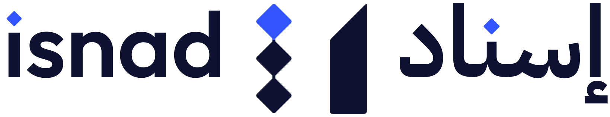
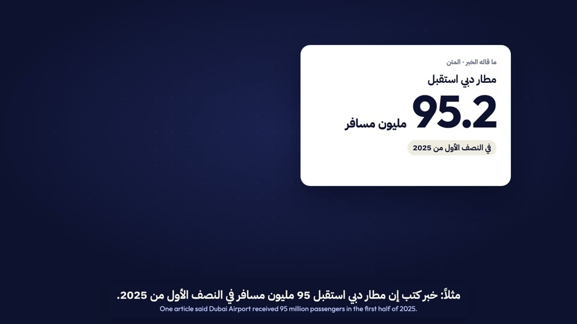
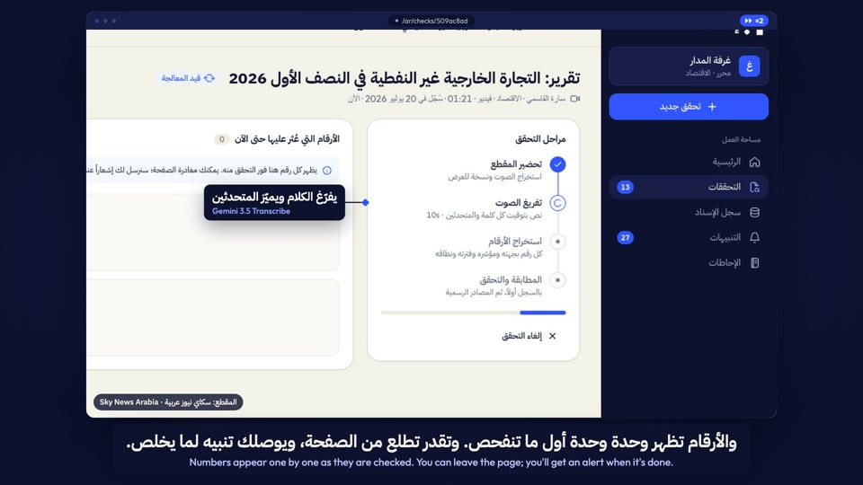
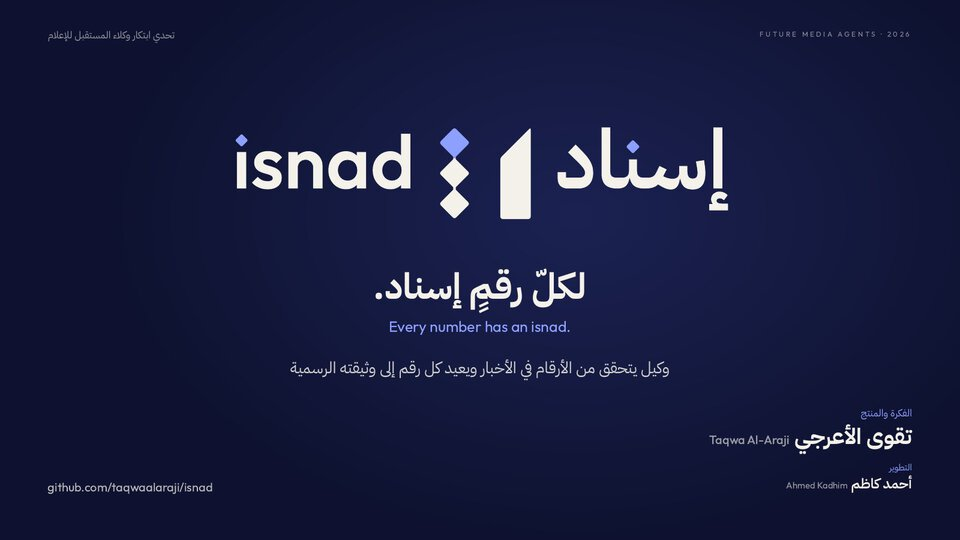
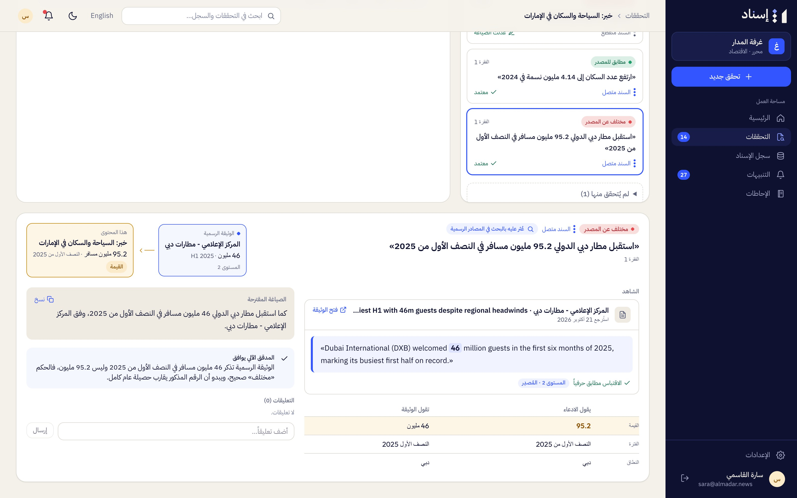
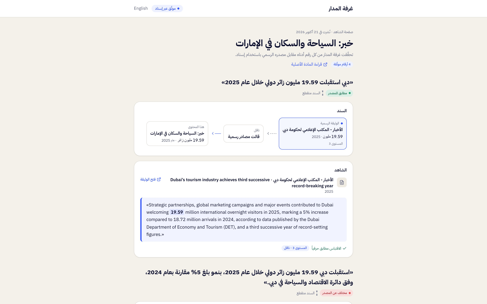
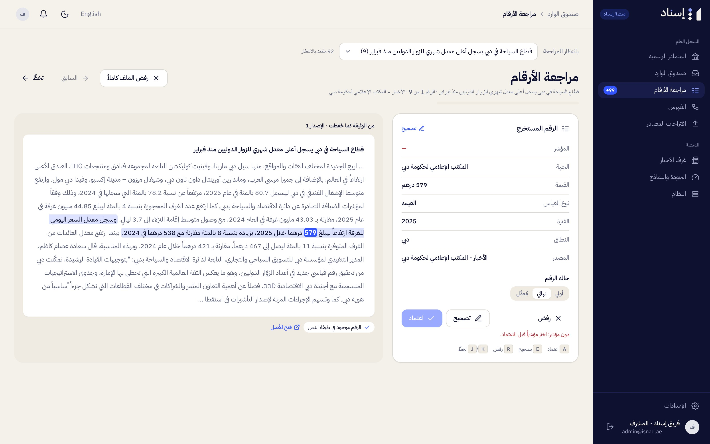
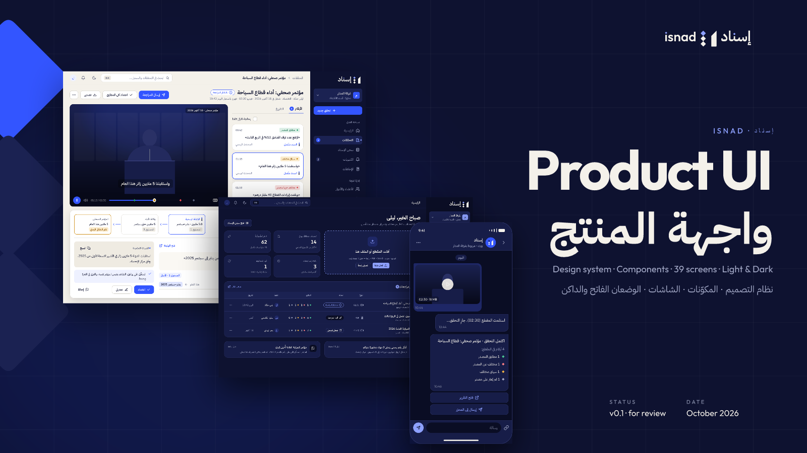

<p align="center">
  <picture>
    <source media="(prefers-color-scheme: dark)" srcset="designs/logos/isnad-logo-bilingual-reversed.svg">
    
  </picture>
</p>

<h1 align="center">Isnad · إسناد</h1>

<p align="center"><b>لكلّ رقمٍ إسناد</b><br>Every number has an isnad</p>

<p align="center">
  <a href="#overview">Overview</a> ·
  <a href="#presentation">Presentation</a> ·
  <a href="#product-screenshots">Screenshots</a> ·
  <a href="#product-docs">Product docs</a> ·
  <a href="#technical-docs">Technical docs</a> ·
  <a href="#designs">Designs</a> ·
  <a href="#run-it-locally">Run it locally</a> ·
  <a href="#team">Team</a>
</p>

## Overview

<table>
<tr>
<td width="50%" valign="top">

**Isnad traces every number in Arabic news back to its official source.**

A newsroom sends a clip, a recording, a document, a link or a text. AI agents transcribe it, find every number, and look for the official document behind each one. For every number Isnad shows the evidence: the document, the exact quote, a verdict (matches, different context, differs, no source) and a suggested wording. An editor makes every final decision, and readers can see the evidence on a public page.

</td>
<td width="50%" valign="top" dir="rtl" align="right">

**«إسناد» يعيد كل رقم في المحتوى الإعلامي العربي إلى مصدره الرسمي.**

ترسل غرفة الأخبار مقطعاً أو تسجيلاً أو وثيقة أو رابطاً أو نصاً، فيفرّغه وكلاء الذكاء الاصطناعي ويستخرجون كل رقم ويبحثون عن الوثيقة الرسمية التي تقف خلفه. ولكل رقم يعرض «إسناد» الشاهد: الوثيقة، والاقتباس الحرفي، والحكم (مطابق، سياق مختلف، مختلف عن المصدر، لم يُعثر على مصدر)، وصياغة مقترحة. القرار الأخير للمحرر دائماً، ويرى القرّاء الشواهد في صفحة عامة.

</td>
</tr>
</table>

## Presentation

<table>
<tr>
<td width="33%" valign="top"><a href="presentation/isnad-video.mp4"></a><br><b><a href="presentation/isnad-video.mp4">The pitch</a></b><br><sub>Video, 2:44 · MP4, 24 MB</sub></td>
<td width="33%" valign="top"><a href="presentation/isnad-walkthrough.mp4"></a><br><b><a href="presentation/isnad-walkthrough.mp4">Full walkthrough</a></b><br><sub>Video, 6:14 · MP4, 46 MB</sub></td>
<td width="33%" valign="top"><a href="presentation/isnad-deck.pdf"></a><br><b><a href="presentation/isnad-deck.pdf">The deck</a></b><br><sub>14 slides in Arabic · PDF</sub></td>
</tr>
</table>

The videos have Arabic narration with Arabic and English captions; the narration and music are AI-generated (Gemini TTS, Lyria). The demo clip is Sky News Arabia's report «2 تريليون درهم.. التجارة الخارجية غير النفطية للإمارات» (20 July 2026), credited on screen; every figure shown comes from a published official UAE source. More in [presentation/](presentation/README.md).

## Product screenshots

<table>
<tr>
<td width="50%"><br><sub>Home: send content and see what awaits review</sub></td>
<td width="50%"><br><sub>A clip with synced captions and a card per number</sub></td>
</tr>
<tr>
<td><br><sub>The evidence: the official document, the exact quote, the chain</sub></td>
<td><br><sub>A number that differs from its source, with a corrected wording</sub></td>
</tr>
<tr>
<td><br><sub>The public evidence page readers see</sub></td>
<td><br><sub>The Isnad Registry: an indicator's official figures over time</sub></td>
</tr>
<tr>
<td><br><sub>Ask Isnad: answers from official figures only, with evidence</sub></td>
<td><br><sub>A curator reviews each extracted figure in its document</sub></td>
</tr>
</table>

**[See all 41 screenshots →](screenshots/README.md)**

## Product docs

What Isnad does and how each role uses it ([index](docs/product/README.md)):

1. [Overview](docs/product/01-overview.md): numbers, verdicts, the chain, source tiers, evidence, the registry
2. [Roles and permissions](docs/product/02-roles-and-permissions.md): who sees and does what
3. [Guide for journalists](docs/product/03-guide-journalist.md)
4. [Guide for editors](docs/product/04-guide-editor.md)
5. [Guide for newsroom admins](docs/product/05-guide-newsroom-admin.md)
6. [Guide for curators and platform admins](docs/product/06-guide-curator.md)
7. [Glossary](docs/product/07-glossary.md): Arabic and English terms

## Technical docs

How Isnad is built, run and deployed ([index](docs/technical/README.md)):

1. [Architecture](docs/technical/01-architecture.md): components, data flow, the job queue, the AI gateway and model choices
2. [Data model](docs/technical/02-data-model.md)
3. [The check pipeline](docs/technical/03-pipeline.md)
4. [The Isnad Registry](docs/technical/04-registry.md)
5. [The worker](docs/technical/05-worker.md)
6. [Worker tools](docs/technical/06-worker-tools.md): the Telegram bot, the test corpus, evaluation
7. [The web app](docs/technical/07-web-app.md)
8. [Security](docs/technical/08-security.md)
9. [Testing](docs/technical/09-testing.md)
10. [Local development](docs/technical/10-local-development.md)
11. [Deployment](docs/technical/11-deployment.md)

## Designs

- **Brand identity:** [brand-identity.pdf](presentation/brand-identity.pdf): the idea, the symbol and its construction, the wordmark, logo versions and colour.
- **Logos and icons:** every lockup as SVG and PNG in [designs/logos/](designs/logos/); app icons, favicons and the Telegram avatar in [designs/icons/](designs/icons/). The rules for using them are in the [designs guide](designs/README.md).
- **Product UI:** the design the app was built from (every screen in light and dark, the components and the design system), made in [FigCraft](https://getartcraft.com/apps/figcraft): [isnad-product-ui.figcraft](designs/ui-ux/isnad-product-ui.figcraft). How to open it, and previews without FigCraft: [UI/UX guide](designs/README.md#uiux-the-product-design-in-figcraft).

<a href="designs/README.md#uiux-the-product-design-in-figcraft"></a>

## Run it locally

You need Docker, Node.js 22+, [uv](https://docs.astral.sh/uv/), the [Supabase CLI](https://supabase.com/docs/guides/local-development/cli/getting-started) and ffmpeg. Then:

```bash
make setup      # install web and worker dependencies
make db         # start local Supabase
make env        # write the local env files
make db-reset   # database, base seed and the demo data
make dev        # web app, worker and Telegram bot
```

Open http://localhost:3000 and sign in with a demo account, for example `sara@almadar.news` (editor). The demo needs no API key; new checks need a Gemini API key, and the Telegram bot a bot token.

**[The full guide →](docs/technical/10-local-development.md)** covers installing the tools, getting a Gemini key, creating a Telegram bot, every demo account and its password, the local addresses and the `make` targets.

## Team

- **Taqwa Al-Araji**: idea and product
- **Ahmed Kadhim**: development

## License

[GNU AGPL-3.0](LICENSE). You may use, change and share Isnad; if you run a modified version as a service, you must publish your changes under the same licence.
