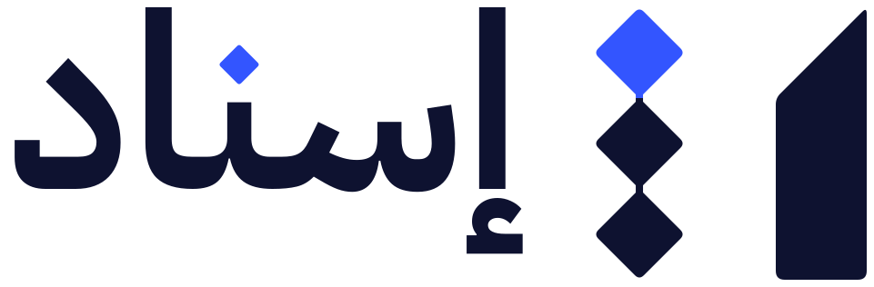
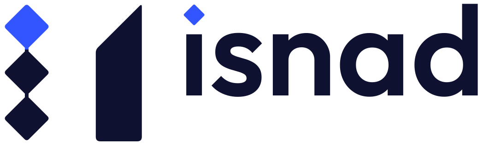
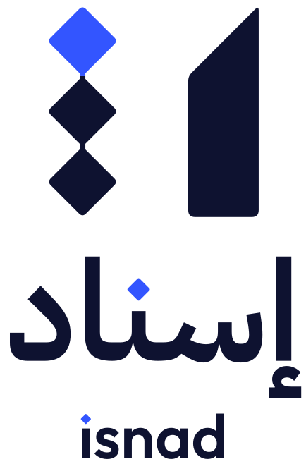
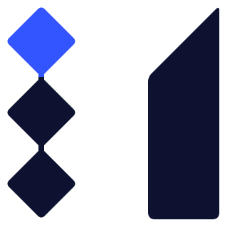
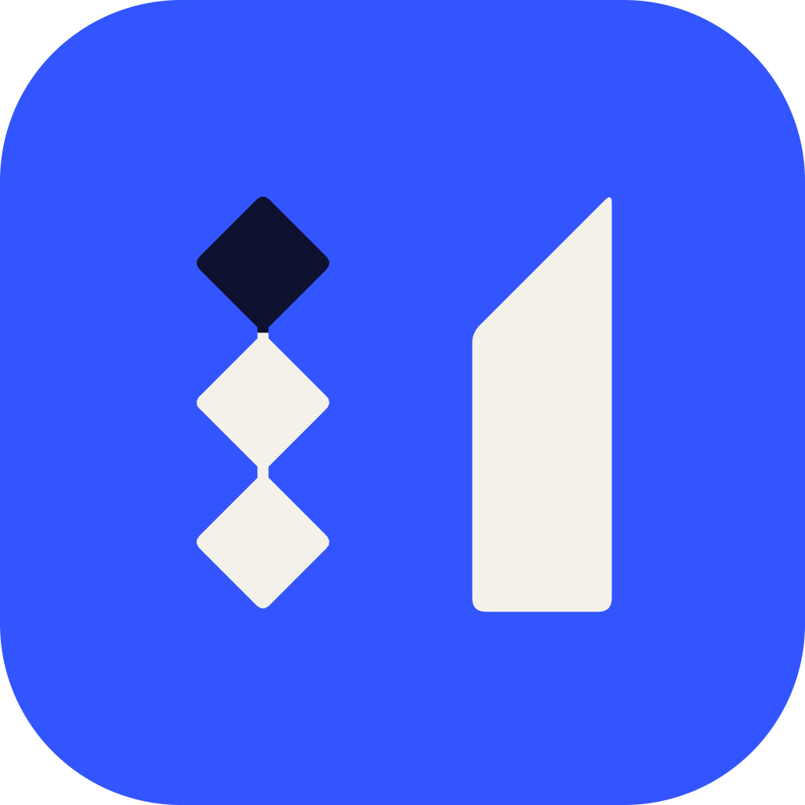
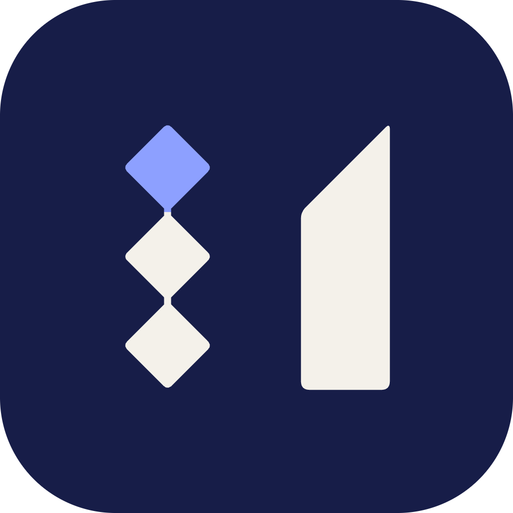
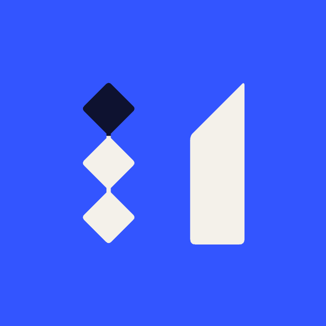

# Designs

<picture>
  <source media="(prefers-color-scheme: dark)" srcset="logos/isnad-logo-bilingual-reversed.svg">
  
</picture>

Isnad's logos, icons and product design. The full brand guide (the idea, the symbol's construction,
clear space, misuse, colour and contrast) is [presentation/brand-identity.pdf](../presentation/brand-identity.pdf).

| Folder | What |
|---|---|
| [`logos/`](logos/) | The logo lockups as SVG, and PNGs for tools without SVG |
| [`icons/`](icons/) | App icons, favicons and the Telegram bot avatar |
| [`ui-ux/`](ui-ux/) | The product UI design in FigCraft, with previews |

## Logos

| Lockup | On light | On dark | Use it for |
|---|---|---|---|
| **Arabic** (primary) | [`isnad-logo-arabic-color.svg`](logos/isnad-logo-arabic-color.svg) | [`isnad-logo-arabic-reversed.svg`](logos/isnad-logo-arabic-reversed.svg) | The default: the app, reports, Telegram, Arabic material |
| **Bilingual** | [`isnad-logo-bilingual-color.svg`](logos/isnad-logo-bilingual-color.svg) | [`isnad-logo-bilingual-reversed.svg`](logos/isnad-logo-bilingual-reversed.svg) | Official and bilingual material: covers, the submission, event screens |
| **Latin** | [`isnad-logo-latin-color.svg`](logos/isnad-logo-latin-color.svg) | [`isnad-logo-latin-reversed.svg`](logos/isnad-logo-latin-reversed.svg) | English-only material |
| **Stacked** | [`isnad-logo-stacked-color.svg`](logos/isnad-logo-stacked-color.svg) | [`isnad-logo-stacked-reversed.svg`](logos/isnad-logo-stacked-reversed.svg) | Square and tall formats: social posts, splash screens |
| **Symbol** | [`isnad-symbol-color.svg`](logos/isnad-symbol-color.svg) | [`isnad-symbol-reversed.svg`](logos/isnad-symbol-reversed.svg) | App icon, avatar, favicon, small spaces |

<table>
<tr>
<td width="50%"><picture><source media="(prefers-color-scheme: dark)" srcset="logos/isnad-logo-arabic-reversed.svg"></picture><br><sub>Arabic (primary)</sub></td>
<td width="50%"><picture><source media="(prefers-color-scheme: dark)" srcset="logos/isnad-logo-latin-reversed.svg"></picture><br><sub>Latin</sub></td>
</tr>
<tr>
<td><picture><source media="(prefers-color-scheme: dark)" srcset="logos/isnad-logo-stacked-reversed.svg"></picture><br><sub>Stacked</sub></td>
<td><picture><source media="(prefers-color-scheme: dark)" srcset="logos/isnad-symbol-reversed.svg"></picture><br><sub>Symbol</sub></td>
</tr>
</table>

More variants: `isnad-logo-arabic-on-lapis.svg` and `isnad-symbol-on-lapis.svg` for lapis backgrounds,
`isnad-logo-arabic-mono-ink.svg` and `isnad-logo-arabic-mono-white.svg` for one colour. In
[`logos/png/`](logos/png/): the Arabic and bilingual lockups 1600 px wide, the symbol 1024 px, colour and
reversed, on transparent backgrounds.

Rules:

- Use these files; never retype the wordmark. The dots of the ن and the i are nuqtas, not the font's dots.
- Never mirror the symbol, in RTL or LTR layouts: the chain stays on the left, the alif on the right.
- Keep clear space of one nuqta (a third of the symbol's height) on every side.
- Colours: **Ink** `#0E1230`, **Lapis** `#3355FF` (on dark backgrounds use **Sky** `#8DA0FF`), **Paper**
  `#F4F1EA`. Lapis marks the source; green, red and amber are kept for verdicts.
- Type: [Outfit](https://fonts.google.com/specimen/Outfit) for Latin and numbers,
  [IBM Plex Sans Arabic](https://fonts.google.com/specimen/IBM+Plex+Sans+Arabic) for Arabic.

## Icons

| File | Use |
|---|---|
| [`app-icon-lapis-rounded-1024.png`](icons/app-icon-lapis-rounded-1024.png), [`app-icon-lapis.svg`](icons/app-icon-lapis.svg) | App icon on lapis (rounded PNG, square SVG) |
| [`app-icon-ink-rounded-1024.png`](icons/app-icon-ink-rounded-1024.png) | App icon on ink |
| [`favicon.svg`](icons/favicon.svg), [`favicon-32.png`](icons/favicon-32.png), [`favicon-192.png`](icons/favicon-192.png), [`favicon-512.png`](icons/favicon-512.png) | Browser and web-app icons |
| [`apple-touch-icon-180.png`](icons/apple-touch-icon-180.png) | Home-screen icon on iPhone and iPad |
| [`telegram-avatar.svg`](icons/telegram-avatar.svg), [`telegram-avatar-640.png`](icons/telegram-avatar-640.png) | The Isnad bot's profile picture on Telegram |

  

## UI/UX: the product design in FigCraft

[](ui-ux/previews/showcase.png)

[`ui-ux/isnad-product-ui.figcraft`](ui-ux/isnad-product-ui.figcraft) is the product design (v0.1) the app
was built from: every screen in Light and Dark, the components and the design system. Without FigCraft,
see the previews: [showcase](ui-ux/previews/showcase.png), [foundations](ui-ux/previews/foundations.png),
[components](ui-ux/previews/components.png); the [screenshots](../screenshots/README.md) show the app as built.

| Page | What's on it |
|---|---|
| **Cover**, **Showcase** | The file's thumbnail; key screens in Light and Dark |
| **01 · Access** | Sign in, check your email, accept an invite |
| **02 · Workspace** | Home, new check, processing, the checks list |
| **03 · Check** | The review screen for video, audio and documents; exporting the isnad note |
| **04 · Registry** | Registry home, Ask Isnad, indicator, entity, document, coverage |
| **05 · Alerts & Briefs** | Alerts, the briefs list, a brief |
| **06 · Settings & Admin** | Profile and notifications, linking Telegram, members and roles, policies, private sources, activity and usage |
| **07 · Isnad Console** | Official sources, adding a source, inbox, figure review, catalog, quality and models, newsrooms |
| **08 · Telegram** | Linking, sending a clip, the summary, an unlinked account (phone size) |
| **09 · Public & States** | The reader's evidence page; empty, no-results, no-source, unreachable, no-access and failed states |
| **Components** | 35 component sets (about 420 components and variants): icons, nuqta and chain, buttons, inputs, labels, navigation, data display, the check page, registry, admin, Telegram |
| **Foundations** | Colour, theme tokens, verdicts, type, shape and elevation, the nuqta, the logo, layout |

The design system: 103 variables (brand primitives, a **Theme** collection with **Light** and **Dark**
modes, radii), 22 styles (Arabic text in IBM Plex Sans Arabic, numbers in Outfit with tabular figures,
three shadows) and the components, which use only Theme variables, so every screen switches theme.
The data in the file is illustrative: «غرفة المدار» is a fictional newsroom.

### Get FigCraft

FigCraft is a free, open-source interface design app by ArtCraft (Apache-2.0): frames, auto layout,
components and variants, variables with modes, styles and prototyping, working offline with no account.

- **Download:** [getartcraft.com/apps/figcraft](https://getartcraft.com/apps/figcraft): the ArtCraft
  Launcher (recommended) or the app for macOS, Windows, Linux or the web.
- **Releases and source:** [github.com/storytold/figcraft](https://github.com/storytold/figcraft/releases)
  (`.dmg` for macOS, `.msi` or portable `.zip` for Windows, AppImage, `.deb`, `.rpm` or Flatpak for Linux).
- FigCraft is in early alpha. The file was made with FigCraft 0.6.

### Use the file

1. Install the two fonts first ([Outfit](https://fonts.google.com/specimen/Outfit),
   [IBM Plex Sans Arabic](https://fonts.google.com/specimen/IBM+Plex+Sans+Arabic)), or the text falls
   back to another font.
2. Open `isnad-product-ui.figcraft` in FigCraft.
3. Start with the **Showcase** page. On each screen page the Light screens are on top and a Dark row
   below; the Dark row shows instances of the same screens with the Theme collection set to Dark.
4. Every screen is a component: edit the Light screen and its Dark instance follows. Components and
   variables live on the **Components** and **Foundations** pages.
5. To export a screen, select its frame and export it as PNG, SVG or PDF.

From the command line, `figcraft-cli` (in the macOS release assets) reads the file without opening the app:

```bash
figcraft-cli info designs/ui-ux/isnad-product-ui.figcraft                 # pages and frames
figcraft-cli export designs/ui-ux/isnad-product-ui.figcraft -o out \
  --format png --scale 2 --page "02 · Workspace"                           # one page's frames as PNG
```
