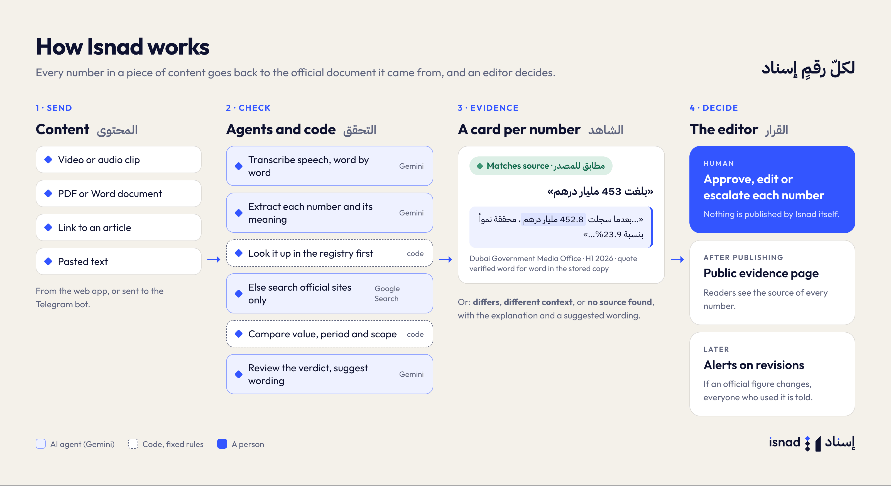
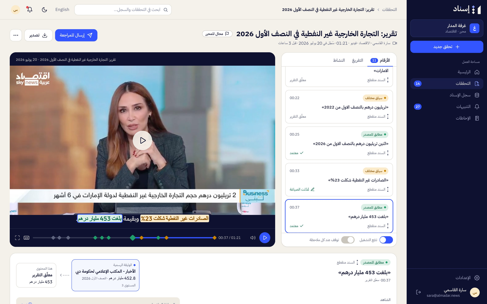
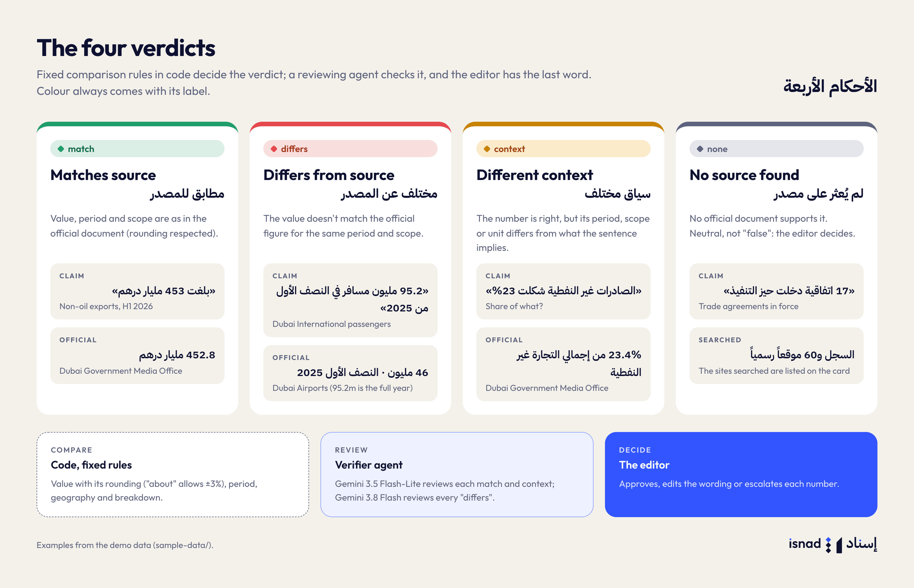
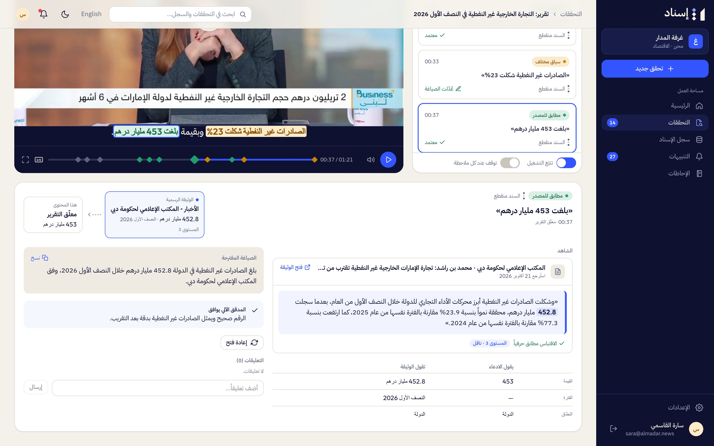
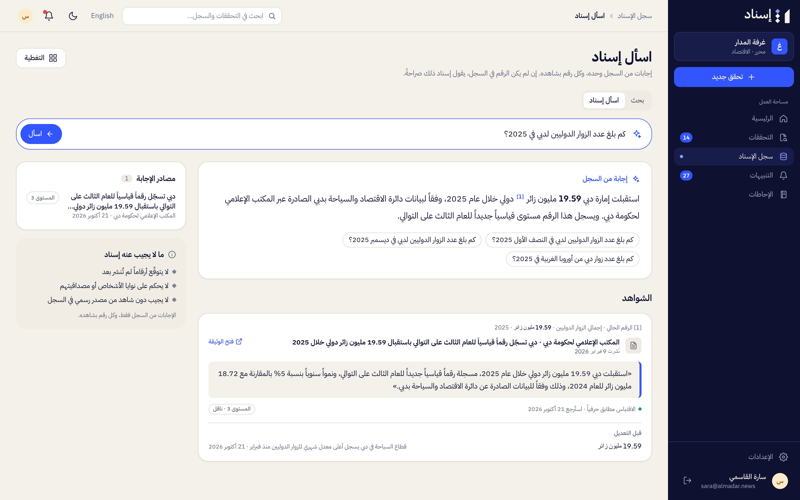

# Isnad Overview

Isnad (إسناد) traces the numbers in Arabic media content back to their official sources. A newsroom sends a clip, an audio recording, a document, a link or a pasted text. Isnad finds every number in it, looks for the official document behind each one, shows the evidence, and suggests a corrected wording when needed. An editor makes every final decision.

Tagline: «لكلّ رقمٍ إسناد» — Every number has an isnad.

## What it does

1. **Check content.** Upload a video or audio clip (up to 500 MB, two hours), a PDF, Word, text or HTML file, paste a link to an article, or paste text; or send it to Isnad's Telegram bot. Isnad transcribes speech (or uses the clip's own captions), finds the numbers, and checks each one.
2. **Show the evidence.** For each number: the official document, the exact sentence or table cell, the period and scope, how the claim differs, and a suggested wording. For video and audio, the numbers sit on the timeline and in the captions.
3. **Support the review.** Editors approve, edit the wording, or escalate numbers, then approve the check and record where it was published. Under the default newsroom policy, every "Differs from source" number needs its own decision; the other pending numbers are approved together with the check.
4. **Keep watching.** Isnad keeps a registry of what official sources published. If a figure used in an approved or published check is later revised, the check's author and reviewer get an alert, and the public evidence page shows the revision.

## Key terms

### Number (claim)

A number stated in the content, with what it measures, for whom, and for which period, anchored to the exact words that say it. Opinions and forecasts are listed separately as not checkable («لم يُتحقق منها»).

### Verdicts

| Verdict | Arabic | English | Meaning |
|---|---|---|---|
| match | مطابق للمصدر | Matches source | Number, period and scope are as in the official document. |
| context | سياق مختلف | Different context | The number is right, but the period, scope or unit differs. |
| differs | مختلف عن المصدر | Differs from source | The number doesn't match the official document for the same period and scope. |
| none | لم يُعثر على مصدر | No source found | No official document supports this number. That doesn't make it wrong. |

Verdicts come from fixed comparison rules, not from a model's opinion. Rounding is respected: "5.1 million" matches an official 5,123,456. "About" (نحو) allows ±3%.

A number that Isnad hasn't searched for yet (beyond a check's automatic search budget) shows «لم يُبحث بعد» (Not searched yet) with a button to search official sources.

### Chain (السند)

The path from the official document to this content: official document → any relay the content names (e.g. a news agency) → this content, with where the number changed.

| State | Arabic | English | Meaning |
|---|---|---|---|
| connected | السند متصل | Connected chain | The number reaches an original official document (tier 1 or 2) that can be opened and checked. |
| broken | السند منقطع | Broken chain | The chain breaks before an original official document (no evidence, or only a relay). |

### Source tiers

| Tier | Arabic | English | Who |
|---|---|---|---|
| 1 | المستوى 1 · الأصل | Tier 1 · Origin | Produces the statistic: statistics centres, open-data portals |
| 2 | المستوى 2 · المُصدِر | Tier 2 · Issuer | Publishes its own official numbers: ministries, authorities, the central bank |
| 3 | المستوى 3 · ناقل | Tier 3 · Relay | Relays numbers: news agencies, government media offices |

### Evidence (الشاهد)

The verbatim sentence or table cell in the official document, with the document title, page or cell, and the date Isnad retrieved it. Isnad shows a figure as evidence only after confirming that the quote is really in its stored copy.

### The Isnad Registry (سجل الإسناد)

A record of what official sources said, when, and where: every figure exactly as published, in a stored copy of its document. It covers 21 topics and 140 sources at setup, and grows with every document Isnad reads, including the ones it finds while checking. Newsrooms search it, follow indicators and entities, and ask questions in plain language (**Ask Isnad**, «اسأل إسناد»), answered only from the registry with evidence for every number.

### Isnad note (ملاحظة الإسناد)

A text block to paste under a story or broadcast script: each approved number with its official source, period and link. Only approved numbers are included.

### Public evidence page (صفحة الشاهد العامة)

When a newsroom records where a check was published, Isnad creates a public page for readers: each approved number that has evidence (numbers with no source found are left out), its chain and its evidence, and a notice if the official figure is later revised. No sign-in needed; no internal notes, comments or names are shown.

### Briefs (الإحاطات)

Before an interview, a journalist prepares a one-page brief on the guest's organisation: its latest official figures on a topic, recent revisions, what it said before in the newsroom's checks, and suggested questions. Every number in it comes from the registry with its evidence.

### Alerts (التنبيهات)

Revised figures, new releases from followed sources, checks that are ready, and numbers waiting for someone's decision arrive in **Alerts**, and in Telegram for people who linked it.

### Telegram

A journalist links their account once, then sends the bot a text, a link, a voice note, a clip or a document (up to 20 MB). The bot shows the progress and replies with a summary and a link to the full report. WhatsApp is planned.

## Who uses it

| Role | Arabic | Does |
|---|---|---|
| Journalist | صحفي | Sends content, reads results, corrects transcripts, sends checks for review, prepares briefs |
| Editor | محرر | Decides on each number, approves checks, records publication |
| Newsroom admin | مدير الغرفة | Everything an editor does, plus members, desks, policies, private sources, activity and usage |
| Curator | أمين السجل | Isnad staff: runs the shared registry (sources, documents, figure review, catalog, proposals) |
| Platform admin | مشرف المنصة | Isnad staff: everything a curator does, plus newsrooms, limits and model settings |

Details: [02-roles-and-permissions.md](02-roles-and-permissions.md). Guides: [journalist](03-guide-journalist.md), [editor](04-guide-editor.md), [newsroom admin](05-guide-newsroom-admin.md), [curator and platform admin](06-guide-curator.md). Terms: [07-glossary.md](07-glossary.md). Every screen: [screenshots](../../screenshots/README.md).

## AI models

Every AI task runs on Google Gemini, each on the model that suits it: Gemini 3.5 Transcribe for speech, Gemini 3.5 Flash-Lite for extracting numbers, searching official sites, reviewing verdicts, wording, Ask Isnad and briefs, with Gemini 3.8 Flash called in only when code rejects the cheaper answer, and Gemini 3.8 Flash for reading official documents. Comparisons and verdicts are code with fixed rules. A check costs about five US cents on average.

## Languages

The interface is in Arabic (default, right to left) and English. Numbers are shown with Western digits in both.

---

[← Product docs](README.md) · [Documentation](../README.md) · [Roles and permissions →](02-roles-and-permissions.md)
