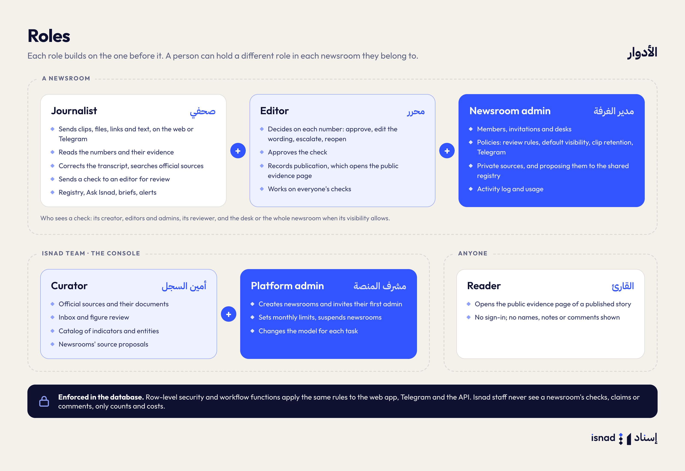
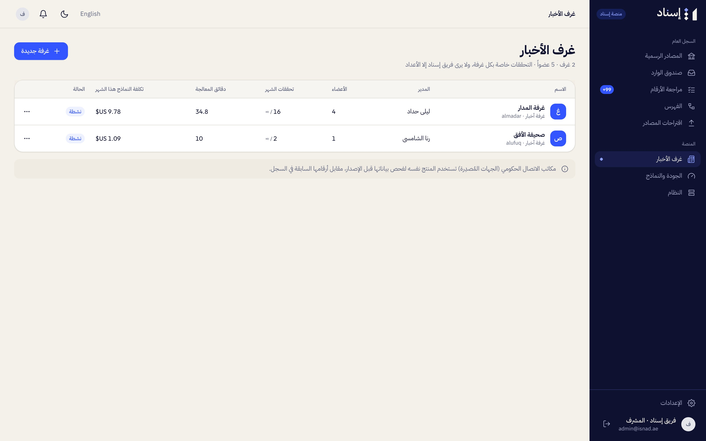

# Roles and Permissions

There are two kinds of roles:

- **Newsroom roles** (per newsroom): journalist (صحفي), editor (محرر), newsroom admin (مدير الغرفة). A person can belong to several newsrooms with a different role in each, and switches newsroom from the sidebar.
- **Platform roles** (Isnad staff): curator (أمين السجل) and platform admin (مشرف المنصة). They work in the Isnad console («منصة إسناد»).

These rules are enforced in the database (row-level security and workflow functions), not only in the interface.

## Who sees which check

A member of the newsroom can open a check when any of these is true:

- Its visibility is «الغرفة كلها» (the whole newsroom).
- They created it.
- They are an editor or newsroom admin.
- They are its assigned reviewer.
- Its visibility is «قسمي» (my desk) and they are on that desk.

A check marked «خاص بي» (private) is visible only to its creator, the assigned reviewer, and the newsroom's editors and admins. People outside the newsroom never see it, and neither do Isnad staff.

The new-check form calls the three choices «الغرفة كلها» / «قسمي» / «خاص بي»; the newsroom's policy page names the same choices «كل الغرفة» / «القسم فقط» / «صاحبه والمحررون».

## Newsroom permissions

| Action | Journalist | Editor | Newsroom admin |
|---|:-:|:-:|:-:|
| Create a check (within the monthly limit) | ✓ | ✓ | ✓ |
| Read checks (per the visibility rules) | ✓ | ✓ | ✓ |
| Comment on a number | ✓ | ✓ | ✓ |
| On own checks: correct the transcript, re-check, search official sources for a number, send for review, archive or cancel | ✓ | ✓ | ✓ |
| The same on other people's checks | — | ✓ | ✓ |
| Decide on a number: approve, edit wording, escalate, reopen | — | ✓ | ✓ |
| Approve all matches | — | ✓ | ✓ |
| Approve a check | — | ✓ | ✓ |
| Record publication (creates the public evidence page) | — | ✓ | ✓ |
| Copy the isnad note, download subtitles | ✓ | ✓ | ✓ |
| Search the registry, Ask Isnad, follow indicators and entities | ✓ | ✓ | ✓ |
| Create briefs | ✓ | ✓ | ✓ |
| Delete a brief | Own | Own | Any |
| Members, invitations, desks | — | — | ✓ |
| Policies (review, visibility default, retention, note branding, Telegram) | — | — | ✓ |
| Private sources, proposing a source to the shared registry | — | — | ✓ |
| Activity log and usage (and CSV export) | — | — | ✓ |

A check's title, desk and visibility can be changed later from the **⋯** menu (**Edit details**, «تعديل البيانات») by its author, editors and admins. An archived check can't be changed.

Limits set by Isnad (the monthly check limit, suspending a newsroom) can't be changed by newsroom admins. A suspended newsroom disappears from its members' newsroom list, in the app and in Telegram. A newsroom always keeps at least one active admin.

Checks sent through Telegram follow the same rules: they are created as the linked member, count towards the monthly limit, and are accepted only when the newsroom's Telegram policy is on.

## Platform permissions

| Action | Curator | Platform admin |
|---|:-:|:-:|
| Official sources: add, edit, pause, fetch now | ✓ | ✓ |
| Inbox: upload documents, retry extraction | ✓ | ✓ |
| Figure review: approve, correct, reject | ✓ | ✓ |
| Catalog: indicators and entities (the 21 topics are fixed) | ✓ | ✓ |
| Proposals: newsroom source proposals, proposed indicators | ✓ | ✓ |
| Newsrooms: view with counts and costs | ✓ (read only) | ✓ |
| Newsrooms: create, set limits, suspend, invite the first admin | — | ✓ |
| Quality and models: model settings, evaluation runs, model usage and cost by day and task; start an evaluation run | ✓ | ✓ |
| Quality: change model settings | — | ✓ |
| System: the job queue, running jobs (cancel), recent failures (retry), worker activity | ✓ | ✓ |

Staff see the registry in full (including pending and rejected figures, and newsrooms' private sources, documents and figures) and newsrooms' activity logs. They never see newsroom content (checks, claims, comments); the console shows counts and costs only.

## What anyone can see without signing in

- The public evidence page of a published check (`/n/<code>`).
- The invitation page, which shows only the newsroom name, the role and a masked email address.

---

[← Overview](01-overview.md) · [Documentation](../README.md) · [Guide for journalists →](03-guide-journalist.md)
