# Guide for Journalists

You send content to Isnad, read what it found, fix the transcript if needed, and send the check to an editor. Editors make the decisions ([04-guide-editor.md](04-guide-editor.md)).

## Sign in

Open the link in your invitation email, or go to the sign-in page and choose a one-time link by email or your password («الدخول بكلمة المرور»). If you belong to several newsrooms, switch from the newsroom card at the top of the sidebar.

## Home

**Home** («الرئيسية») shows a drop zone for new content, this week's checks, the numbers verified, what is processing, and what awaits review (for journalists: your own checks that have an escalated number), with the latest alerts.

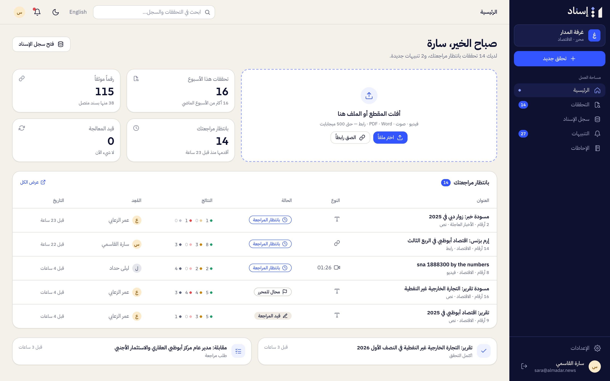

**Checks** («التحققات») lists every check you can see, with filters (الكل · تحققاتي · بانتظار مراجعتي · معتمدة · منشورة · مؤرشفة) and a title search. The search box in the top bar («ابحث في التحققات والسجل…») searches checks and the registry together.

## Start a check

From **Home** drop a file on the drop zone, or choose **New check** («تحقق جديد»).

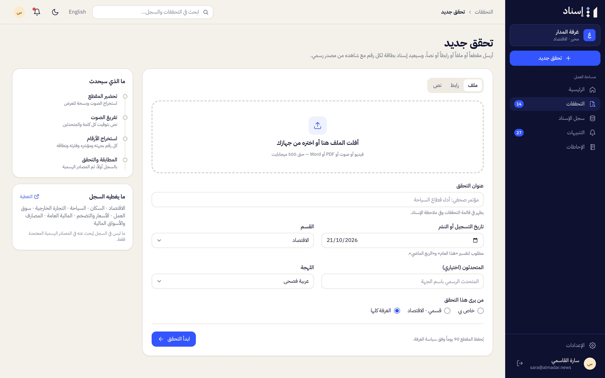

1. Choose the input:
   - **File** («ملف»): video, audio, PDF, Word, text or HTML, up to 500 MB.
   - **Link** («رابط»): an article, press release or official page. Video-platform links (YouTube, TikTok, X, Instagram) aren't supported: download the clip and upload it.
   - **Text** («نص»): paste the story or statement.
2. Fill in the details:
   - **Check title** («عنوان التحقق») — shown in lists and in the isnad note.
   - **Recorded or published on** («تاريخ التسجيل أو النشر») — needed to read "this year" or "last quarter" correctly.
   - **Desk** («القسم»), **Speakers** («المتحدثون»), **Dialect** («اللهجة») for audio and video.
   - **Who can see this check** («من يرى هذا التحقق»): only you, your desk, or the whole newsroom.
3. Press **Start check** («ابدأ التحقق»).

If your newsroom has reached its monthly limit, Isnad says so and doesn't create the check.

## While it processes

The check page shows the stages: preparing the clip, transcribing, finding the numbers, matching and verifying. Numbers appear as soon as each one is checked. You can leave the page; you'll get a "check ready" alert («اكتمل التحقق»).

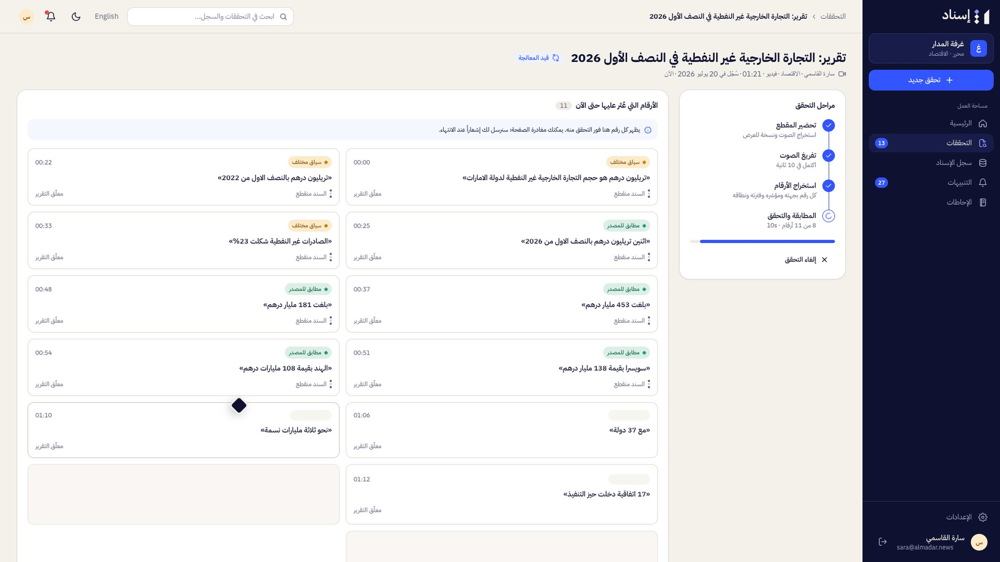

To stop it, press **Cancel check** («إلغاء التحقق»). If it fails, the page says why (for example, no readable text, or the link couldn't be opened) and offers **Try again** («إعادة المحاولة»).

Clips that carry their own caption track are read from the captions. Others are transcribed automatically, with speakers and word timings.

## Read the results

The check page has:

- **Numbers** («الأرقام»): a card per number with its verdict, its place (time or paragraph) and the chain state. **Needs a decision only** («بحاجة لقرار فقط») hides decided numbers. Use `j` and `k` to move between numbers, and Space to play or pause.
- **Transcript** («التفريغ») for audio and video, or **Text** («النص») for documents, links and pasted text.
- **Activity** («النشاط»): who did what.
- The **stage**: the video or audio player with captions and coloured markers on the timeline, or the document with the numbers highlighted. Click a marker or a number to jump to it. **Follow playback** («تتبّع التشغيل») keeps the current number in view; **Pause at each issue** («توقف عند كل ملاحظة») stops at every number that differs or has a different context.
- The **evidence panel** for the selected number: the official document and the exact quote, what the claim says vs what the document says, the suggested wording, the automatic verifier's note, earlier figures, and comments.

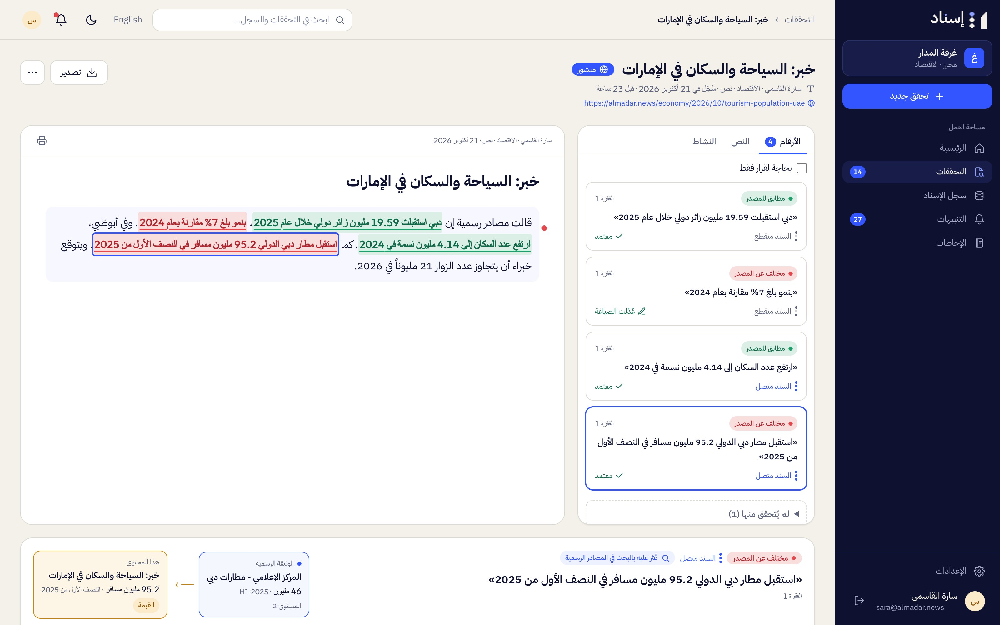

Numbers that weren't checked (opinions, forecasts) are listed under **Not checked** («لم يُتحقق منها») with the reason.

A number marked **Not searched yet** («لم يُبحث بعد») wasn't in the registry and wasn't among the numbers Isnad searched automatically. Press **Search official sources** («ابحث في المصادر الرسمية») to search for it. When nothing is found, the card says so and lists the official sites searched; the closest official figure, if any, is shown under **Latest value** («آخر قيمة»).

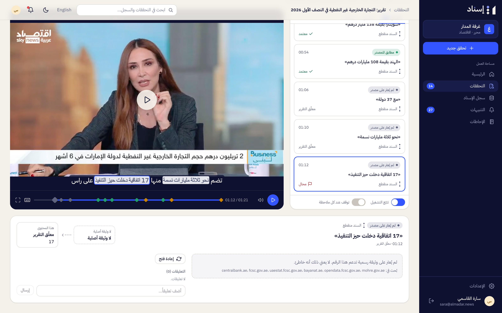

## Fix the transcript

In the **Transcript** tab (or **Text** for documents and text), hover a line and press the edit icon. Correct the words and press **Save and re-check** («حفظ وإعادة التحقق»). Only the numbers in that line are checked again. Published and archived checks can't be edited.

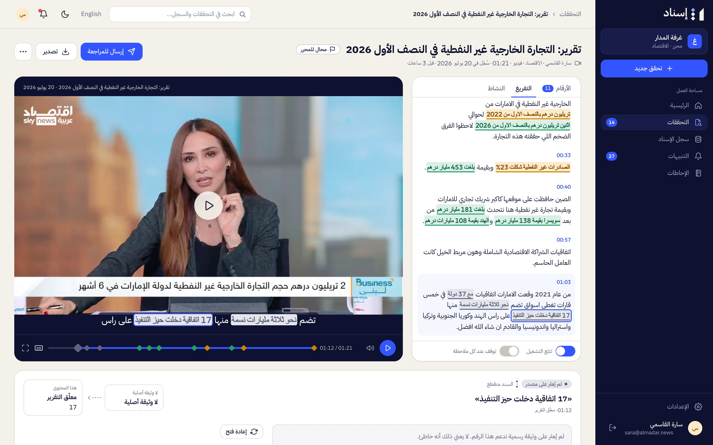

## Send for review

Press **Send for review** («إرسال للمراجعة»), choose an editor or **Any editor on the desk** («أي محرر في القسم»), and send. The editor gets an alert; "any editor" alerts every editor on the check's desk (all editors when it has no desk) and the newsroom's admins.

## Other actions

- **Comment** on any number in the evidence panel.
- **Re-check against today's registry** («إعادة التحقق بسجل اليوم») from the **⋯** menu, when official figures may have changed.
- **Export** («تصدير»): copy the **isnad note** («ملاحظة الإسناد», approved numbers only) or download **subtitles (SRT)** for audio and video.
- **Archive** («أرشفة») your own checks.

## Use the registry

**Isnad Registry** («سجل الإسناد») lets you search indicators, entities, figures and documents (results also include **your newsroom's checks**, «تحققات غرفتك»), browse topics, open an indicator's history and chart, and **Follow** («متابعة») indicators and entities to get alerts on new figures and releases. An indicator page offers **Use in a check** («استخدام في تحقق»). **Coverage** («التغطية») shows what the registry covers, by topic.

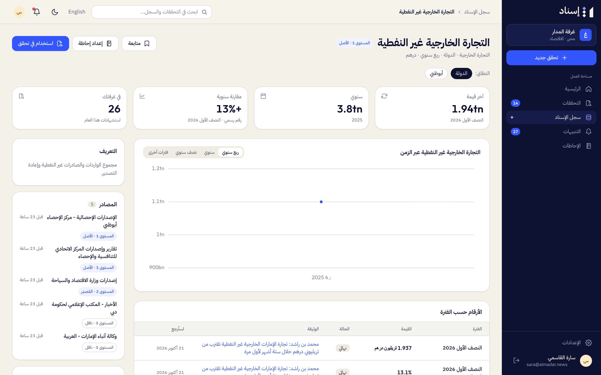

**Ask Isnad** («اسأل إسناد») answers questions from the registry only, with evidence for every number, in the language of the question, and suggests follow-up questions.

## Briefs

**Briefs** («الإحاطات») prepare you for an interview. Choose the guest's entity («الجهة»), an optional topic, the period («الفترة», the last 3 to 24 months), the guest's name and the interview date, and what the sheet includes («تتضمن الورقة»): recent revisions, the entity's earlier statements you checked, suggested questions. Isnad writes the sheet in Arabic: the entity's latest official figures, recent revisions, what it said before in your newsroom's checks, and suggested questions, every number linked to its evidence. You can also start a brief from an entity or indicator page («إعداد إحاطة»).

On a brief: **Refresh sheet** («تحديث الورقة»), **Print** («طباعة»), **Copy sheet link** («نسخ رابط الورقة») for colleagues, or delete your own.

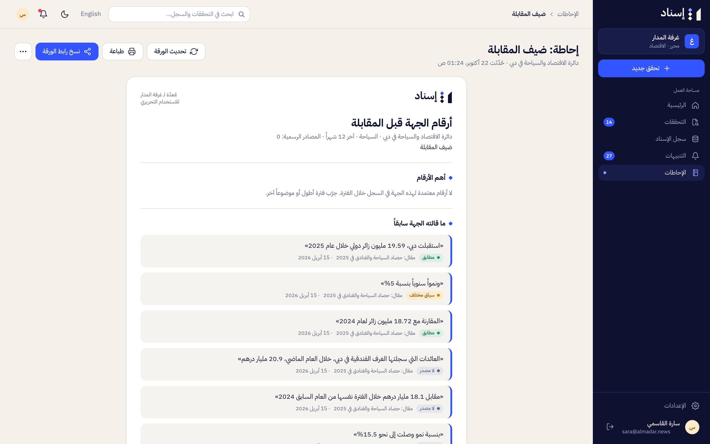

## Alerts

**Alerts** («التنبيهات») collects revised figures, new releases from what you follow, checks that are ready and numbers waiting for you. Filter by all, unread, revisions, releases, awaiting your decision or checks ready; mark one or all as read («تعليم الكل كمقروء»), or dismiss («تجاهل»). The side panel lists what you follow («ما تتابعه») and links to how alerts reach you («تغيير طريقة الإيصال»).

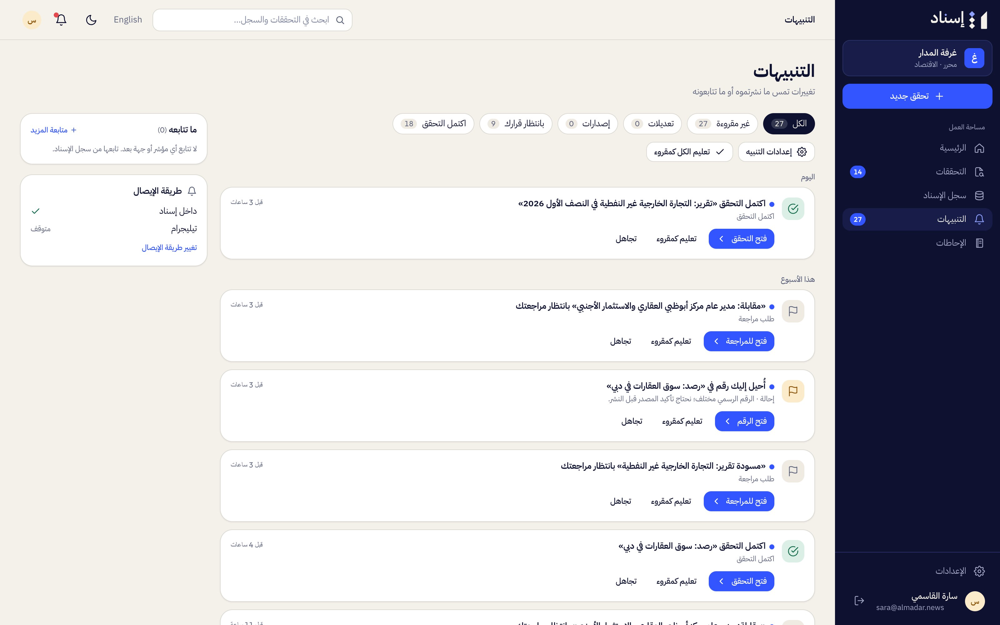

## Telegram

Link your account once, under **Settings → Channels** («القنوات»): scan the code or press **Open Telegram** («فتح تيليجرام»). The link works once, for ten minutes.

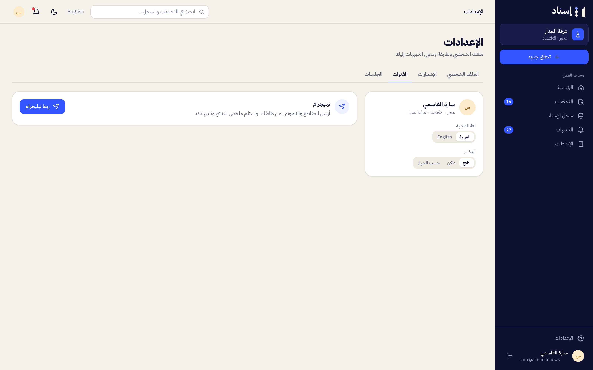

Then send the bot a text, a link, a voice note or clip, or a PDF or Word file (up to 20 MB). It replies at once, edits its message as the check progresses, and ends with a summary of the numbers and their verdicts, with **Open report** («فتح التقرير») and **Send to editor** («إرسال إلى المحرر») buttons. New checks get your newsroom's default visibility. Commands: `/checks` (your latest checks), `/alerts` (unread alerts), `/desk` (your newsroom and desk; switch newsroom), `/unlink`, `/help`.

## Settings

**Settings** («الإعدادات») has four tabs:

- **Profile** («الملف الشخصي»): your name, interface language, theme and password.
- **Notifications** («الإشعارات»): which alerts reach you on Telegram, with a master switch («تنبيهات تيليجرام»).
- **Channels** («القنوات»): linking Telegram.
- **Sessions** («الجلسات»): sign out on your other devices («إنهاء الجلسات على الأجهزة الأخرى»).

Isnad works on a phone too:

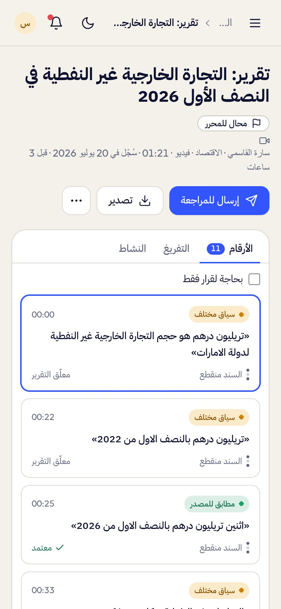

---

[← Roles and permissions](02-roles-and-permissions.md) · [Documentation](../README.md) · [Guide for editors →](04-guide-editor.md)
