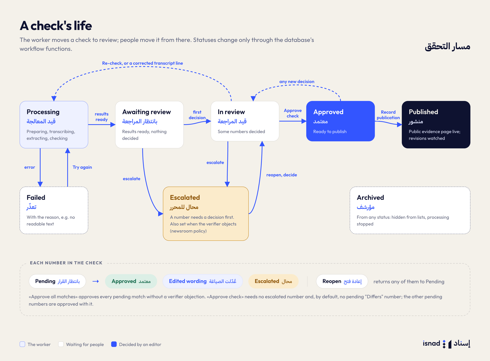
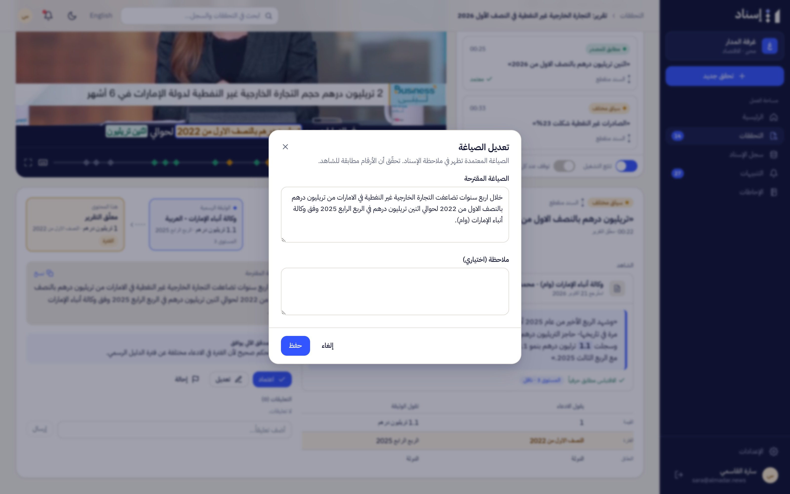
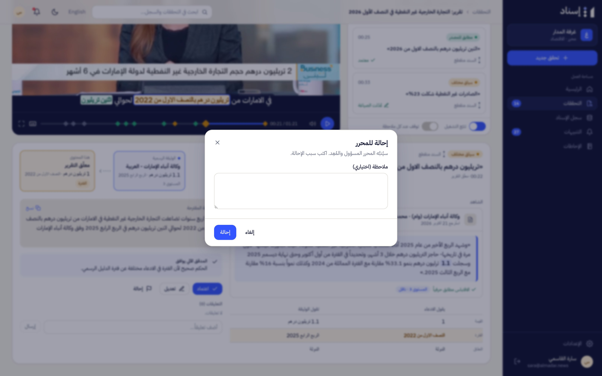
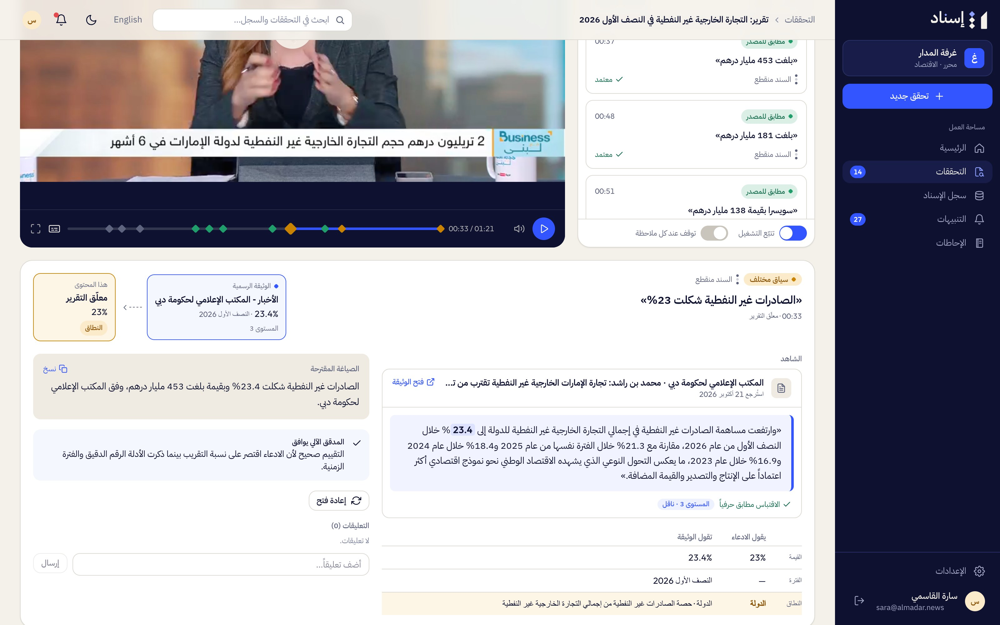

# Guide for Editors

Editors decide on the numbers before a story goes out. Isnad compares and explains; you approve. Everything a journalist can do also applies to you ([03-guide-journalist.md](03-guide-journalist.md)).

## Find work

- **Home** («الرئيسية») shows checks awaiting review, the oldest first, and your latest alerts.
- **Checks** («التحققات») → **Awaiting my review** («بانتظار مراجعتي») lists every check that is awaiting review, in review or escalated, and is either unassigned or assigned to you.
- A **Review requested** alert («طلب مراجعة») links straight to the check; in **Alerts**, the **Awaiting you** filter («بانتظار قرارك») shows them all.

## Review a check

Open the check. The first number needing attention is selected (differences first). For each number, read the evidence panel:

- The **verdict** and the **chain** state.
- The **official document** and the highlighted quote, with the page or cell and the retrieval date. **Open document** («فتح الوثيقة») shows the stored copy at that exact spot.
- **The claim says / The document says** («يقول الادعاء» / «تقول الوثيقة») for value, period and scope, with the differing field highlighted.
- The **suggested wording** («الصياغة المقترحة»), with **Copy** («نسخ»).
- The **automatic verifier's note** («المدقق الآلي»). When it agrees, the panel says **The automatic verifier agrees** («المدقق الآلي يوافق»). When it objects, the number isn't included in "approve all matches", and under the default newsroom policy it is **escalated automatically** when processing finishes, so the check opens as **Escalated**.
- **Earlier figures** from the same entity (official revisions), and **comments** from colleagues.

Then decide:

| Button | Arabic | Effect |
|---|---|---|
| Approve | اعتماد | Accept the number as stated |
| Edit | تعديل | Approve with a corrected wording (it goes into the isnad note) and an optional note |
| Escalate | إحالة | Refer it with an optional note («ملاحظة (اختياري)»); the check's assigned reviewer and its author are alerted, and the check is Escalated until it's resolved |
| Reopen | إعادة فتح | Undo a decision. An escalated number only offers Reopen: reopen it, then decide |

**Approve all matches** («اعتماد كل المطابق») approves every pending number that matches its source and has no verifier objection.

<table>
<tr>
<td width="50%"> Edit the wording</td>
<td width="50%"> Escalate with a note</td>
</tr>
</table>

## Approve and publish

1. **Approve check** («اعتماد التحقق») appears when no number is escalated and, when the newsroom's policy «كل نتيجة "مختلف عن المصدر" تتطلب اعتماد محرر» is on (the default), no "Differs from source" number is still pending. The other pending numbers are approved together with the check; with that policy off, all of them are.
2. After the story is out, press **Record publication** («تسجيل النشر») and paste its link (you can record it again later from the **⋯** menu). Isnad then:
   - creates the **public evidence page** («صفحة الشاهد العامة»), available from **Export**; numbers with no source found are left out of it;
   - watches the official figures behind the approved numbers and alerts the check's author and reviewer if any is revised (**Official figure revised**, «تعديل رقم رسمي»), for approved checks as well as published ones.
3. Copy the **isnad note** («ملاحظة الإسناد») from **Export** and paste it under the story.

Any new decision moves an approved check back to **In review**.

## Verdicts in practice

| Verdict | Usual action |
|---|---|
| Matches source (مطابق للمصدر) | Approve (or approve all matches) |
| Different context (سياق مختلف) | Usually edit the wording to state the right period or scope |
| Differs from source (مختلف عن المصدر) | Edit with the official value, or escalate |
| No source found (لم يُعثر على مصدر) | Not wrong by itself: approve if you trust the attribution, or search official sources, or escalate |

## Statuses

| Status | Arabic | Meaning |
|---|---|---|
| Processing | قيد المعالجة | Isnad is working |
| Awaiting review | بانتظار المراجعة | Results ready, nothing decided (a check can go straight to Escalated when the verifier objected) |
| In review | قيد المراجعة | Some decisions made |
| Escalated | محال للمحرر | A number is escalated |
| Approved | معتمد | Ready to publish |
| Published | منشور | Publication recorded; public page live |
| Archived | مؤرشف | Hidden from lists |
| Failed | تعذّر | Processing stopped; see the reason on the page |

The same screens in English and on a phone:

<table>
<tr>
<td width="62%"></td>
<td width="38%"></td>
</tr>
</table>

---

[← Guide for journalists](03-guide-journalist.md) · [Documentation](../README.md) · [Guide for newsroom admins →](05-guide-newsroom-admin.md)
