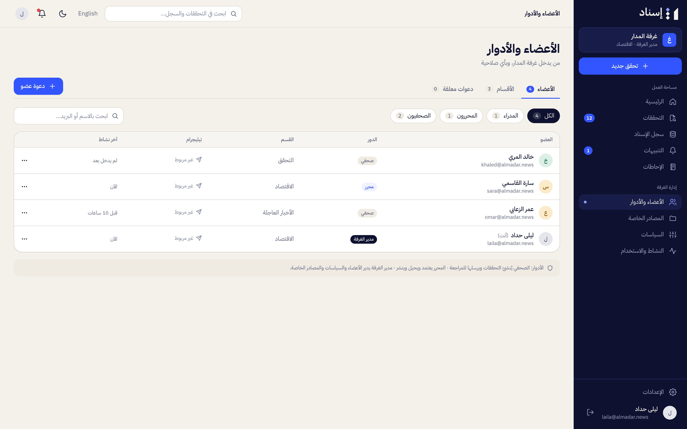
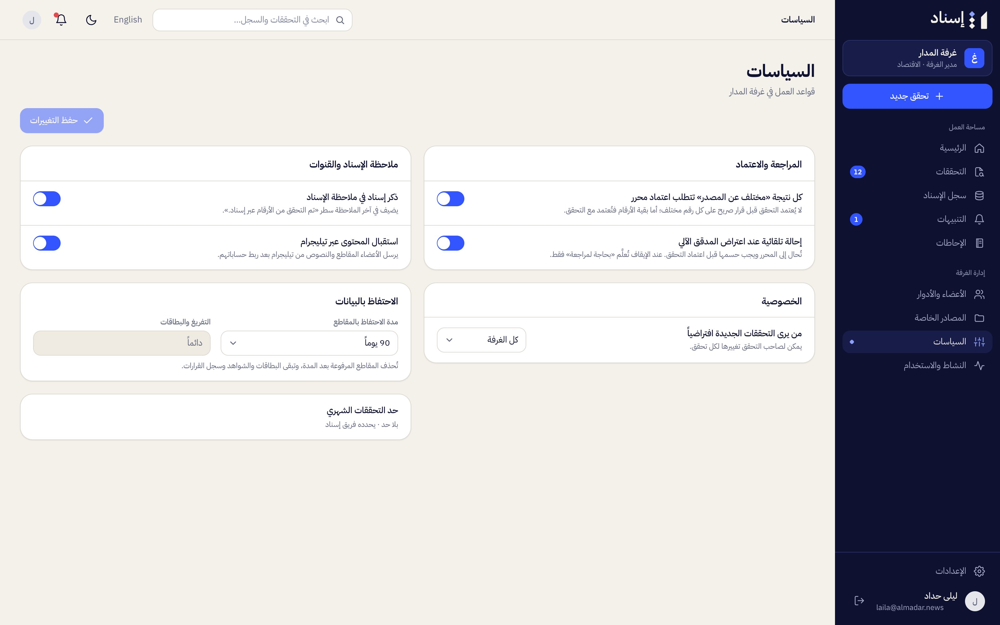
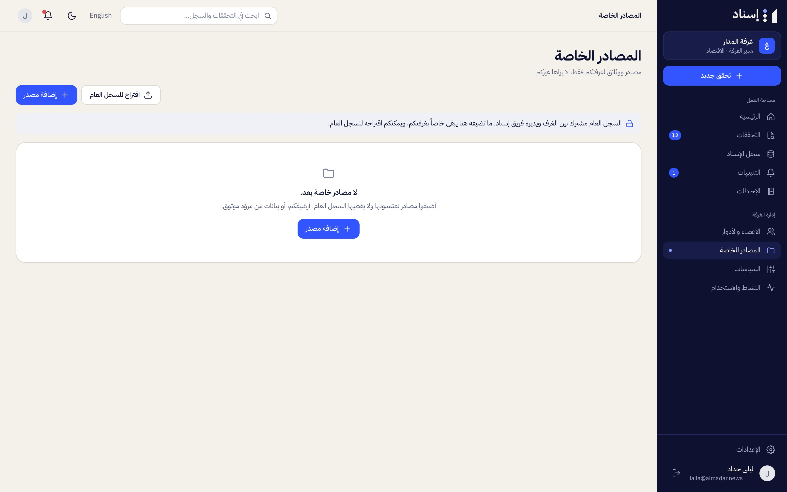
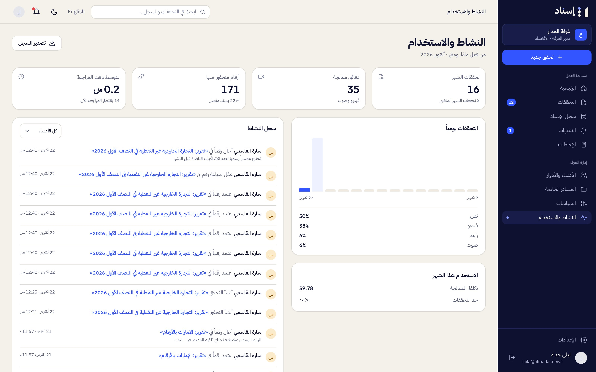

# Guide for Newsroom Admins

A newsroom admin (مدير الغرفة) runs the newsroom in Isnad: people, desks, rules, private sources, and usage. Admins can also do everything an editor does ([04-guide-editor.md](04-guide-editor.md)). The admin pages are under **Newsroom admin** («إدارة الغرفة») in the sidebar.

## Members and roles

**Members and roles** («الأعضاء والأدوار») has three tabs: **Members** («الأعضاء»), **Desks** («الأقسام») and **Pending invitations** («دعوات معلقة»).

- **Invite member** («دعوة عضو»): email, name, role (journalist, editor or admin) and desk. The person gets an email with a link valid for 14 days. A new person sets a password on the invitation page; someone with an account signs in and accepts. The invitation only works for the invited address.
- **Pending invitations**: resend (a new link; the old one stops working) or revoke («إلغاء الدعوة»).
- **Members**: each with their role, desk, whether Telegram is linked, and when they were last active. Change a member's role or desk, or deactivate and reactivate them («إيقاف الحساب» / «تفعيل الحساب»). A deactivated member loses access to the newsroom at once. The newsroom must always keep at least one active admin, so the last admin can't be demoted or deactivated.
- **Desks**: add, rename or delete desks. Desks organize checks and route review requests. Deleting a desk leaves its members and checks without a desk.

Who sees what is explained in [02-roles-and-permissions.md](02-roles-and-permissions.md).

## Policies

**Policies** («السياسات»):

| Setting | Arabic | Effect |
|---|---|---|
| Every "Differs from source" result needs an editor's approval | كل نتيجة «مختلف عن المصدر» تتطلب اعتماد محرر | On (default): a check can't be approved while a "Differs" number is still pending. Off: pending numbers of every verdict are approved with the check |
| Escalate cards the automatic verifier objects to | إحالة تلقائية عند اعتراض المدقق الآلي | On (default): when processing finishes, numbers the verifier objected to are escalated, so they need a decision before the check is approved |
| Who sees new checks by default | من يرى التحققات الجديدة افتراضياً | Preselected in the new-check form (the creator can change it per check), and used for checks sent through Telegram |
| Keep uploaded clips for | مدة الاحتفاظ بالمقاطع | 30, 60, 90 (default), 180 or 365 days. Only uploaded video and audio are deleted; transcripts, results and decisions always stay |
| Credit Isnad on the isnad note | ذكر إسناد في ملاحظة الإسناد | Adds the line «تم التحقق من الأرقام عبر إسناد.» at the end of the isnad note |
| Accept content through Telegram | استقبال المحتوى عبر تيليجرام | Whether members may send content from Telegram. When off, members still receive their alerts in Telegram |

The monthly check limit is shown here but set by the Isnad team.

## Private sources

**Private sources** («المصادر الخاصة») are sources only your newsroom sees (for example, a partner's data). Add, edit or pause them; a source that already has stored documents can't be deleted, so pause it instead. When Isnad searches official sources for your newsroom's numbers, it also searches your private sources' domains, and what it finds there stays private to your newsroom. (Uploading documents to a private source isn't available yet.)

**Propose for the shared registry** («اقتراح للسجل العام») sends a copy of the source to the Isnad team as a proposal. Your private source stays active and is still searched meanwhile. If the proposal is accepted, the copy becomes part of the shared registry for every newsroom. A pending proposal can be withdrawn («سحب الاقتراح»); a rejected one can be removed («إزالة»).

## Activity and usage

**Activity and usage** («النشاط والاستخدام») shows this month's checks against the limit, minutes of audio and video processed, numbers checked, the average review time, checks per day by type, and the processing cost; and who did what (checks created, decisions, invitations, policy changes), with a filter by member. **Export log** («تصدير السجل») downloads the latest 500 entries as CSV.

---

[← Guide for editors](04-guide-editor.md) · [Documentation](../README.md) · [Guide for curators and platform admins →](06-guide-curator.md)
