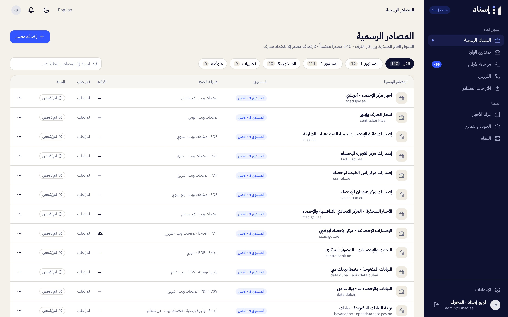
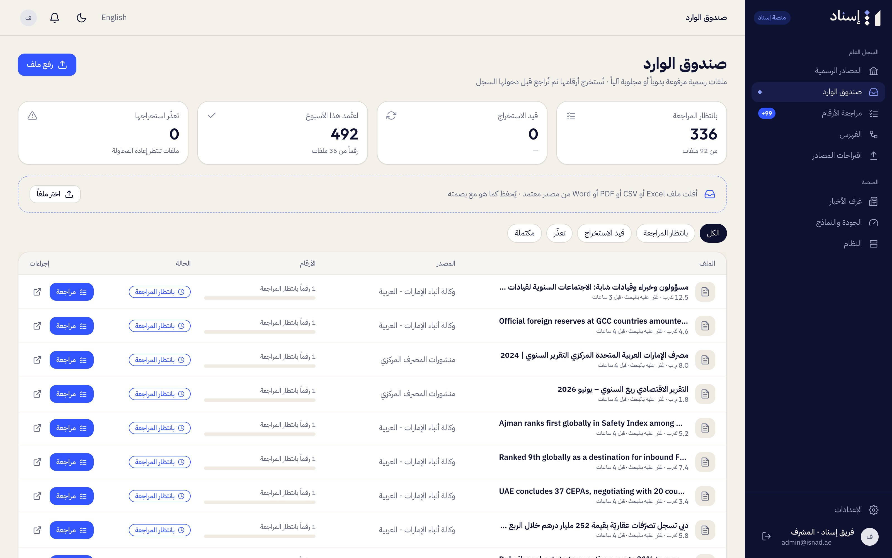
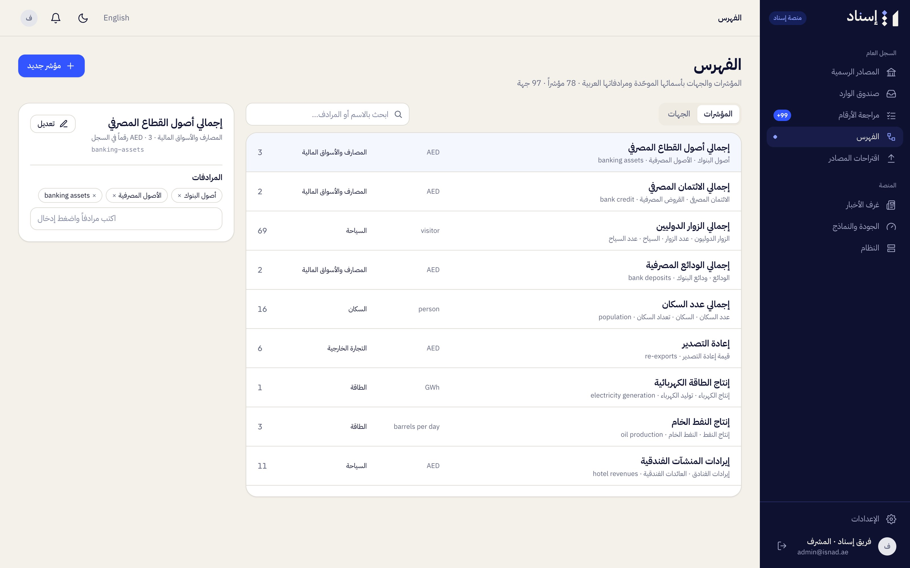
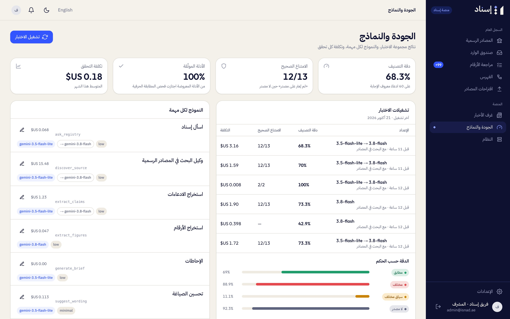
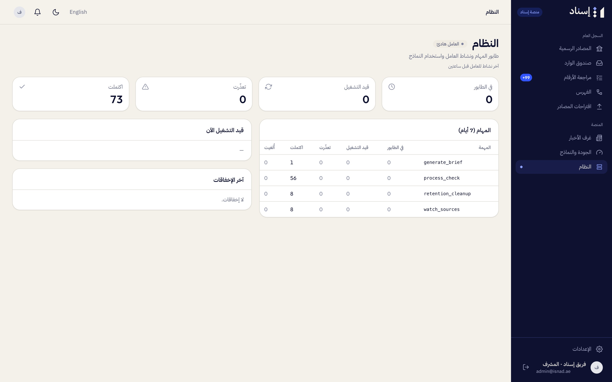

# Guide for Curators and Platform Admins

Isnad staff run the shared registry and the platform from the **Isnad console** («منصة إسناد», `/console`). Curators (أمين السجل) look after sources and figures; platform admins (مشرف المنصة) also manage newsrooms and models. Staff never see newsroom content (checks, claims, comments), only counts and costs.

## Official sources

**Official sources** («المصادر الرسمية»):

- The list shows each source's tier, health, last fetch, and document and figure counts, with filters (all, tier 1, tier 2, tier 3, warnings, paused) and search.
- **Add source** («إضافة مصدر»): entity, identifier, Arabic and English names, tier, type, website and data page, domains, access methods, topics, languages, update frequency, descriptions, the terms-of-use link (with a confirmation that you checked them), and optionally a first document link; then **Approve source** («اعتماد المصدر»). Isnad only fetches and searches on a source's domains, so check the site, its domains and its terms of use first. News agencies and media offices must be tier 3; a first document must be on the source's domains.
- Open a source to edit or pause it, add a document by link (**Add a document**, «إضافة وثيقة»), or press **Fetch now** («اجلب الآن») to re-fetch all its documents.

Tiers: 1 Origin (produces the statistic), 2 Issuer (publishes its own numbers), 3 Relay (relays others' numbers). See [01-overview.md](01-overview.md#source-tiers).

## Inbox

**Inbox** («صندوق الوارد») lists every document version with its extraction status: uploaded by hand, fetched on schedule, found by search while checking, or loaded at setup. **Upload a file** («رفع ملف») adds an official document (PDF, Excel, CSV, Word, HTML or text, up to 100 MB) to a source; Isnad stores it as published with its fingerprint and extracts its figures. **Extract again** («إعادة الاستخراج») is offered for failed documents and documents that produced no figures.

## Figure review

**Figure review** («مراجعة الأرقام») is the queue of pending figures, from document extraction and from searches made while checking. It works file by file: pick a file, or move with **Next file** («الملف التالي») and **Skip** («تخطٍّ»).

For each figure you see the quote highlighted in its document (the passage, the PDF page or the spreadsheet cells around it) and its fields: indicator, value, scale, unit, period, geography, breakdown, measure.

| Key | Action |
|---|---|
| `j` / `k` | Next / previous figure |
| `a` | Approve («اعتماد») |
| `e` | **Fix** («تصحيح») the fields, then **Save correction** («حفظ التصحيح») |
| `r` | Reject («رفض»), with an optional reason |

**Approve {n} verified** («اعتماد {n} موثّقة») approves at once every figure of the file whose quote was verified. **Reject the whole file** («رفض الملف كاملاً») rejects every pending figure of a document. A figure needs an indicator before it can be approved. Correcting a value clears its "verified" mark.

Approving a figure from a shared source makes it available to every newsroom (a figure from a newsroom's private source stays with that newsroom). If it replaces an earlier figure from the same publisher for the same indicator, period and scope, the earlier one is kept as history, and newsrooms with approved or published checks that used the old value get a revision alert. When it replaces nothing, people following the indicator or entity get a "New figure" alert.

## Catalog

**Catalog** («الفهرس») has two tabs: **Indicators** (with aliases, unit kind and topic) and **Entities**. The 21 topics are fixed. Aliases help Isnad match the way journalists name things. **New indicator** («مؤشر جديد»), **New entity** («جهة جديدة»).

## Source proposals

**Source proposals** («اقتراحات المصادر»; the page is titled «الاقتراحات»):

- **Sources proposed by newsrooms**: **Accept** («قبول») makes the source shared and active for every newsroom; **Reject** («رفض») marks it rejected. Your note is saved with the decision.
- **Proposed indicators**: figures the extractor couldn't map to an existing indicator. Create the indicator and assign it; **Dismiss** («تجاهل») leaves the figures in review.

## Newsrooms (platform admins)

**Newsrooms** («غرف الأخبار») lists every newsroom with its members, checks this month against its limit, minutes processed, this month's model cost and its status (Isnad's internal evaluation newsroom is hidden). Platform admins create a newsroom (name, slug, type: a newsroom or an issuer such as a government communications office, and the first admin, who gets an invitation; **Invite admin**, «دعوة مدير», sends another), set its monthly check limit, and suspend or reactivate it. Curators see this page read-only.

## Quality and models

**Quality and models** («الجودة والنماذج»):

- **Model settings** per task: speech to text, claim extraction, the automatic verifier, the official-source search agent, figure extraction, wording polish, Ask Isnad and briefs. For each: the model, the thinking level (minimal, low, medium or high), the escalation model for the five tasks that have one (claim extraction, the verifier, source search, figure extraction, Ask Isnad; asked again only when code checks reject the first answer), maximum output, and on/off for optional tasks. Every task runs on the Gemini API. The defaults: Gemini 3.5 Transcribe for speech; Gemini 3.5 Flash-Lite for claim extraction, the verifier, source search and Ask Isnad (escalating to Gemini 3.8 Flash), and for wording and briefs; Gemini 3.8 Flash for figure extraction. Only platform admins can change them; changes apply within a minute. Extraction and speech to text can't be switched off.
- **Evaluation runs**: **Run the test set** («تشغيل الاختبار») runs the labelled test claims through the pipeline and reports classification accuracy, correct abstentions, rejected quotes, evidence verified, cost per check and cost by task.
- **Model usage** over the last 30 days, by day and task, and the cost of each check.

## System

**System** («النظام»): jobs over the last seven days by kind and status, **Running now** (cancel a queued job, «إلغاء»), **Recent failures** with their error (**Retry**, «إعادة»), and the worker's latest activity.

---

[← Guide for newsroom admins](05-guide-newsroom-admin.md) · [Documentation](../README.md) · [Glossary →](07-glossary.md)
