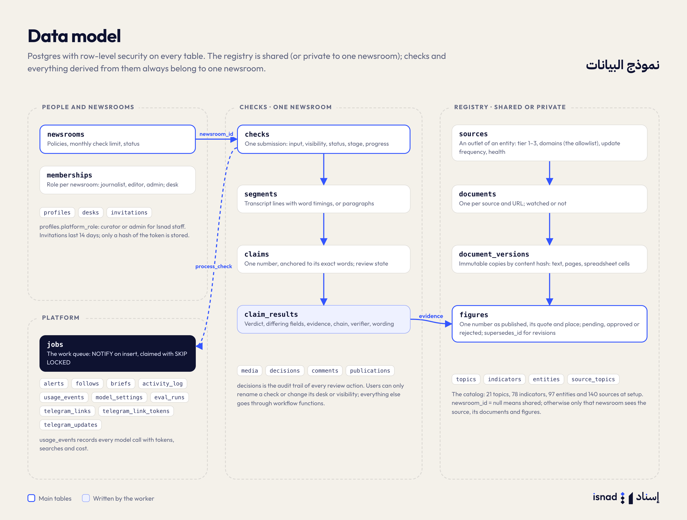

# Data Model

All tables are in the `public` schema of Postgres, created by the migrations in `supabase/migrations/`. Every table has row-level security on (see [08-security.md](08-security.md)). Generated TypeScript types live in `web/src/lib/database.types.ts` (`make types`).

## Tenancy rule

There are two kinds of data:

- **Shared registry** — what official sources published. Rows with `newsroom_id = null` in `sources`, `documents` and `figures` belong to everyone and are curated by Isnad staff.
- **Newsroom-private data** — checks and everything derived from them, alerts, briefs, follows, activity. Always scoped by `newsroom_id`. A newsroom can also keep private sources (`sources.newsroom_id = <newsroom>`); their documents and figures carry the same `newsroom_id` and are visible only to that newsroom.

Staff (curators and platform admins) can read the registry in full, but newsroom content (checks, claims) is never exposed to the console, only counts.

## People and newsrooms

| Table | Key columns | Notes |
|---|---|---|
| `profiles` | `id` (= `auth.users.id`), `email`, `full_name`, `locale` (`ar`/`en`), `platform_role` (`none`/`curator`/`admin`), `notification_prefs` (jsonb), `last_newsroom_id` | Created by a trigger for every auth user. Users can't change their own `platform_role` or `email` (trigger). |
| `newsrooms` | `name`, `slug`, `kind` (`newsroom`/`issuer`), policy columns, `monthly_check_limit`, `status` (`active`/`suspended`), `internal` | `internal` marks Isnad's own newsroom for evaluation runs (`isnad-eval`), hidden from newsroom lists. Policies: `require_approval_for_differs`, `escalate_on_verifier_objection`, `default_visibility`, `media_retention_days`, `brand_isnad_note`, `telegram_enabled`. Only platform admins change slug, kind, status and the limit (trigger). |
| `desks` | `newsroom_id`, `name` | Sections inside a newsroom (e.g. الاقتصاد). |
| `memberships` | (`newsroom_id`, `user_id`), `role` (`journalist`/`editor`/`admin`), `desk_id`, `status` (`active`/`deactivated`) | A newsroom always keeps one active admin (trigger, error `last_admin`). |
| `invitations` | `newsroom_id`, `email`, `role`, `desk_id`, `token_hash` (sha256), `expires_at` (14 days), `accepted_at`, `revoked_at` | One open invitation per address per newsroom. The raw token only exists in the email link. |

## Registry

| Table | Key columns | Notes |
|---|---|---|
| `topics` | `slug`, `name_ar`, `name_en`, `icon`, `sort_order` | 21 seeded topics. |
| `entities` | `slug`, names, `kind` (statistics office, ministry, ...), `level` (federal/emirate/international/other), `emirate`, `website`, `aliases`, `search_text` | Who publishes or is quoted. `search_text` is a normalized generated column with a trigram index. |
| `indicators` | `slug`, `topic_id`, names, `aliases`, `unit_kind`, `unit`, `frequency`, `default_geography`, `search_text` | What is measured (e.g. international visitors). 78 seeded. |
| `sources` | `newsroom_id` (null = shared), `entity_id`, `slug`, names, `tier` (1–3), `type` (the outlet type: statistics releases, news, open data, ...), `domains[]`, `access_methods[]`, `update_frequency`, `status` (`active`/`paused`/`proposed`/`rejected`), `health`, `health_note`, `last_fetched_at`, `verified_at`, `languages`, `proposed_by`, `proposal_note` | An outlet of an entity (e.g. its statistics releases). `domains` is the allowlist for fetching and discovery. |
| `source_topics` | (`source_id`, `topic_id`) | Used to rank domains for discovery. |
| `documents` | `source_id`, `newsroom_id`, `title`, `url`, `kind` (`pdf`/`xlsx`/`csv`/`html`/`docx`/`text`), `language`, `published_at`, `watch`, `current_version_id` | One per (source, URL). |
| `document_versions` | `document_id`, `version`, `storage_path`, `content_hash`, `mime_type`, `page_count`, `fetched_at`, `fetched_via` (`upload`/`schedule`/`discovery`/`seed`), `fetched_by`, `text_content`, `text_normalized`, `tables` (jsonb), `extraction_status`, `extraction_error`, `figures_count`, `previous_version_id` | Immutable snapshots. Same content → same version (unique per hash): for PDFs and spreadsheets the hash is of the file; for HTML and text it is `text:` + the sha256 of the normalized extracted text, so a page whose markup changes on every fetch isn't a new version. `tables` holds spreadsheet cells (`{"kind":"sheet","sheet","cells"}`) or PDF page texts (`{"kind":"pdf_pages","pages"}`). |
| `figures` | `document_version_id`, `document_id`, `source_id`, `newsroom_id`, `indicator_id`, `entity_id`, `value`, `scale` (one/thousand/million/billion/trillion), `decimals`, `value_base`, `unit`, `period_start`/`period_end`/`period_label`, `geography`, `breakdown`, `measure`, `status` (preliminary/final/revised), `location` (jsonb), `quote`, `quote_verified`, `review_status` (pending/approved/rejected), `review_note` (e.g. a proposed indicator), `reviewed_by`, `reviewed_at`, `supersedes_id`, `is_current`, `published_at` | "What a source said": one number, exactly as published, with where it is in the document. `measure` says what the number is for its indicator: `level`, `growth_yoy`, `growth_qoq`, `growth`, `share`, `rank`, `change`. Only approved figures are used as registry evidence. |

Revisions: a newer figure from the same publisher (the same source or entity) for the same indicator, measure, period, geography and breakdown points to the older one with `supersedes_id`, and the older one gets `is_current = false`. Both stay; the newer one gets `status = revised` when the value changed beyond the published precision. See [04-registry.md](04-registry.md).

## Checks

| Table | Key columns | Notes |
|---|---|---|
| `checks` | `newsroom_id`, `created_by`, `desk_id`, `title`, `input_kind` (`video`/`audio`/`document`/`text`/`link`), `channel` (`web`/`telegram`), `input_text`, `input_url`, `storage_path`, `recorded_at`, `speakers`, `dialect`, `visibility` (`private`/`desk`/`newsroom`), `status`, `stage`, `progress` (jsonb), `assigned_editor_id`, verdict counters, `decided_count`, `published_url`, `public_slug`, `error` | One submission. Users can only rename it, move it to a desk or change visibility; everything else changes through workflow functions or the worker (trigger). |
| `media` | `check_id`, `has_video`, `duration_ms`, `width`, `height`, `video_path`, `audio_path`, `poster_path`, `waveform` | Written by the worker for audio and video. |
| `segments` | `check_id`, `idx`, `start_ms`, `end_ms`, `speaker`, `text`, `words` (jsonb word timings), `page`, `low_confidence`, `edited_by`, `edited_at` | Transcript lines for media; paragraphs for documents, links and text. |
| `claims` | `check_id`, `idx`, `segment_id`, `span_text`, `span_start`/`span_end`, `start_ms`/`end_ms`, `speaker`, `entity_text`/`entity_id`, `indicator_text`/`indicator_id`, `value`, `scale`, `unit`, `value_base`, `decimals`, `qualifier` (exact/about/more_than/less_than/at_least/up_to), `period_text`/`period_start`/`period_end`, `geography`, `breakdown`, `claim_type` (level/growth/share/rank/pp_change/ratio), `attribution`, `checkable`, `uncheckable_reason`, `review_state` (pending/approved/edited/escalated) | One number in the content, anchored to its exact words. |
| `claim_results` | `claim_id`, `verdict` (match/context/differs/none), `differing_fields[]`, `chain_status` (connected/broken), `figure_id`, `document_version_id`, `evidence` (jsonb), `evidence_verified`, `comparison` (jsonb, incl. `search`), `verifier` (jsonb), `needs_review`, `suggested_wording`, `searched_sources`, `chain`, `earlier_figures`, `discovered` | One per claim. Rewritten by a re-check. |
| `decisions` | `check_id`, `claim_id`, `user_id`, `action`, `note`, `wording` | The audit trail of review actions (`approve`, `edit`, `escalate`, `reopen`, `send_for_review`, `approve_check`, `publish`, `archive`, `recheck`). |
| `comments` | `check_id`, `claim_id`, `user_id`, `body` | Discussion on a number or a check. |
| `publications` | `check_id`, `url`, `published_at`, `created_by` | Where the piece was published. |

### Check statuses

`processing` → `awaiting_review` → `in_review` (after any decision) → `approved` → `published`. Side states: `escalated` (any number escalated), `failed`, `archived`. Stages while processing: `queued`, `preparing`, `transcribing`, `extracting`, `checking`, `done`.

## Platform

| Table | What it holds |
|---|---|
| `follows` | A user following an indicator or entity in a newsroom. |
| `alerts` | `kind` (`figure_revised`, `new_release`, `new_figure`, `review_requested`, `check_ready`, `check_escalated`), `title`, `body`, `payload` (links), `read_at`, `dismissed_at`, delivery timestamps. `user_id = null` means the whole newsroom. |
| `briefs` | Interview briefs: `entity_id`, `topic_id`, `guest_name`, `interview_date`, `status` (generating/ready/failed), `content` (jsonb). |
| `activity_log` | Newsroom and platform audit events (`log_activity`). |
| `usage_events` | Every model call: `task`, `provider`, `model`, `input_tokens` (audio included), `cache_read_tokens`, `output_tokens`, `search_queries`, `audio_seconds`, `cost_usd`, `duration_ms`, newsroom and check. |
| `model_settings` | Per task: `provider` (`google`), `model`, `effort` (the Gemini thinking level: `minimal`/`low`/`medium`/`high`), `escalation_model` (must differ from `model`), `max_tokens`, `enabled`. `extract_claims`, `extract_figures` and `transcribe` must stay enabled (check constraint). |
| `eval_runs` | Evaluation runs against the labelled test set: `status`, `settings`, `metrics`, `results`. |
| `telegram_links`, `telegram_link_tokens` | A user's linked Telegram account; one-time link tokens (hashed, 10-minute expiry). |
| `telegram_updates` | One row per Telegram update id, so each update is handled once. |
| `jobs` | The work queue ([01-architecture.md](01-architecture.md#job-queue)). |

## Text normalization

Arabic text is matched in a normalized form, implemented three times and kept in sync:

| Where | Function |
|---|---|
| SQL | `public.normalize_ar(text)` (generated `search_text` columns) |
| Worker | `isnad_worker.text.normalize` / `normalize_for_match` (NFKC first, for PDF presentation forms) |
| Web | `normalizeAr` in `web/src/lib/text.ts` |

It unifies alef forms, `ى`→`ي`, `ة`→`ه`, converts Arabic-Indic and Persian digits and the Arabic decimal, thousands and percent signs to ASCII, drops tatweel and diacritics, and lowercases.

---

[← Architecture](01-architecture.md) · [Documentation](../README.md) · [The check pipeline →](03-pipeline.md)
