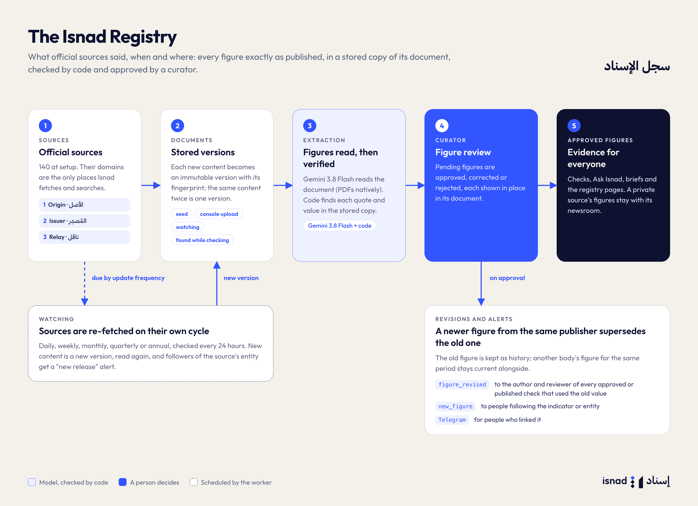

# The Isnad Registry

The registry stores **what official sources said**: each number exactly as published, in a stored copy of the document, with where it is in that document. Checks compare claims against it. It never stores a judgment of which number is "true"; a revision is a new figure that supersedes the old one, not a contradiction.

## Catalog

| Object | Meaning | Example |
|---|---|---|
| Topic | A subject area | السياحة |
| Indicator | What is measured | إجمالي الزوار الدوليين |
| Entity | Who publishes or is quoted | دائرة الاقتصاد والسياحة في دبي |
| Source | One outlet of an entity, with its domains | Its press releases |

The seed (`worker/seed_data/`) loads 21 topics, 78 indicators, 97 entities and 140 UAE and international sources. Staff edit the catalog in the console.

## Source tiers

| Tier | Label (ar / en) | Meaning |
|---|---|---|
| 1 | المستوى 1 · الأصل / Tier 1 · Origin | Produces the statistic (statistics centres, open-data portals) |
| 2 | المستوى 2 · المُصدِر / Tier 2 · Issuer | Publishes its own official numbers (ministries, authorities, central bank) |
| 3 | المستوى 3 · ناقل / Tier 3 · Relay | Relays others' numbers (news agencies, media offices) |

Only tier 1 and 2 evidence makes a chain **connected** ([03-pipeline.md](03-pipeline.md#chain)). A source's `domains` list is its allowlist: Isnad only fetches and searches there.

## Documents and versions

`registry/store.py`:

- `store_version` keeps one `documents` row per (source, URL) and an immutable `document_versions` row per distinct content: the sha256 of the file for PDFs and spreadsheets, and of the normalized extracted text for HTML and text (so a page whose markup changes on every fetch isn't a new version). Storing the same content again returns the existing version. A new version points to the previous one.
- The file is saved in the `documents` bucket as `<source>/<document>/v<n>.<ext>`.
- Text is extracted at once: PDF text per page (kept in `tables` as `pdf_pages` for page-level quote checks), spreadsheet cells as `{sheet, cells: {"C12": value}}` (XLSX, XLS, CSV), DOCX paragraphs, and HTML main content.

Documents arrive in four ways (`fetched_via`): `seed`, `upload` (console inbox), `schedule` (watching), `discovery` (found while checking).

## Figure extraction

The `ingest_document` job (`registry/ingest.py`, task `extract_figures`):

1. Sends the document to Gemini 3.8 Flash with the indicator catalog. PDFs are attached natively: up to 20 pages are read whole; longer ones are cut to the most relevant pages (ranked by catalog terms and digit density, pages with no score skipped), at most 40, sent as a PDF of those pages with a map back to the original page numbers (text is sent instead only when a batch exceeds 18 MB). Spreadsheets, HTML and DOCX go as text in chunks of 90,000 characters, spreadsheets as `REF=value` lines.
2. The model proposes figures: indicator slug (or a proposed new indicator), value, scale, decimals, unit, period, geography, breakdown, measure, status, location and the verbatim quote.
3. **Code verifies each one** against the stored copy (when a text figure's quote doesn't match, the document's own sentence holding the value stands in): a spreadsheet figure takes its value from the referenced cell; the quote and number must be found in the document (page text for PDFs). The result is stored in `quote_verified`. Unverified figures are kept as pending for a curator, and are never auto-approved; at check time every figure is verified again before it is shown as evidence.
4. Units are normalized (`%`, AED, USD, singular English nouns) and period labels are generated from the dates.
5. Figures are saved as `pending`. With `auto_approve` (seeding), verified figures that map to a catalog indicator are approved at once and linked to earlier figures straight away (`revisions.link`).
6. Ingestion marks the source healthy and sets its `last_fetched_at`. If an escalation model is configured for `extract_figures` (none by default), a batch where fewer than half the figures verify is read again by it.

Pending figures from earlier runs of the same version are replaced.

## Review and approval

Curators review pending figures in the console (**Figure review**): the quote is shown in its document context, fields can be corrected (`update_figure`), and figures are approved (`approve_figures`, requires an indicator) or rejected (`reject_figures`). Figures proposing a new indicator are resolved under **Proposals** (`assign_indicator` or `dismiss_indicator_proposal`).

Only approved figures are used as registry evidence and are visible to newsrooms.

## Revisions and alerts

Approval queues `figures_approved`, which runs `registry/revisions.link` for each figure:

- An earlier approved, current figure **from the same publisher** (the same source or entity, fetched no later) for the same indicator, measure, geography, period and breakdown (and the same newsroom scope) is superseded: it gets `is_current = false`, and the new figure's `supersedes_id` points to it. Another body's figure for the same indicator and period stays current alongside it. The new figure gets `status = revised` only when the value differs by more than the coarser published precision.
- If the value changed, every newsroom that used the old figure in an approved or published check gets a `figure_revised` alert (to the check's creator and assigned editor).
- When the figure supersedes nothing, members following the indicator or entity get a `new_figure` alert.
- Every new alert for a member who linked Telegram queues `deliver_alerts` (a trigger on `alerts`), which sends it there if they want that kind.

The public evidence page shows a revision notice when the figure behind a published number has been superseded.

## Watching sources

A scheduler in the worker queues `watch_sources` every `WATCH_INTERVAL_HOURS` (24). It queues `refetch_document` for the watched documents of active sources that are due, by the source's `update_frequency` counted from the current version's `fetched_at`: daily after 20 hours, weekly after 3 days, monthly after 7, quarterly after 14, annual after 30, otherwise 7. The worker also queues `watch_sources` as soon as it starts. A re-fetch downloads the URL again; new content becomes a new version, is queued for extraction, and members following the source's entity get a `new_release` alert. The source's `health` and `last_fetched_at` are updated (a failed fetch sets health to `warning`).

Staff can also **Fetch now** (`fetch_source_now`, which re-fetches every document of the source that has a URL, watched or not) or add a document by link or upload (`add_source_document` → `register_document` job, `registry/intake.py`). Links must be on the source's domains.

## Newsroom-private sources

A newsroom admin can add private sources (**Private sources**). Their documents and figures carry the newsroom's id and are only visible to that newsroom; checks in that newsroom use them like shared ones. An admin can also propose a source to the shared registry (`status = proposed`); staff accept (it becomes shared and active) or reject it under **Source proposals**.

## Reading the registry in the web app

The registry pages (`/registry/...`) use SQL functions that run as the viewer, so RLS decides what each person sees: `registry_search` (ranked search where every query word must match, with trigram fallback), `registry_stats`, `registry_topic_stats`, `source_is_fresh` (freshness from each source's update cycle) and `figure_excerpt` (the passage or the spreadsheet cells around one figure).

## Ask Isnad

`POST /internal/ask` on the worker API (`isnad_worker/ask.py`, task `ask_registry`), called by the web app with the internal token:

1. Retrieves candidate approved figures by normalized text and catalog matches (shared plus the newsroom's private ones).
2. The model answers only from those figures and cites figure ids.
3. Code checks that every cited id was among the candidates and every number in the answer belongs to a cited figure (or is a date or period of one). Answers must cite with `[n]` markers. A wrong number is retried on Gemini 3.8 Flash; an answer without citations or markers is retried on Flash-Lite, then Flash; after three attempts it is replaced by "no evidence in the registry". The answer is written in the question's language and offers follow-up questions.

---

[← The check pipeline](03-pipeline.md) · [Documentation](../README.md) · [The worker →](05-worker.md)
