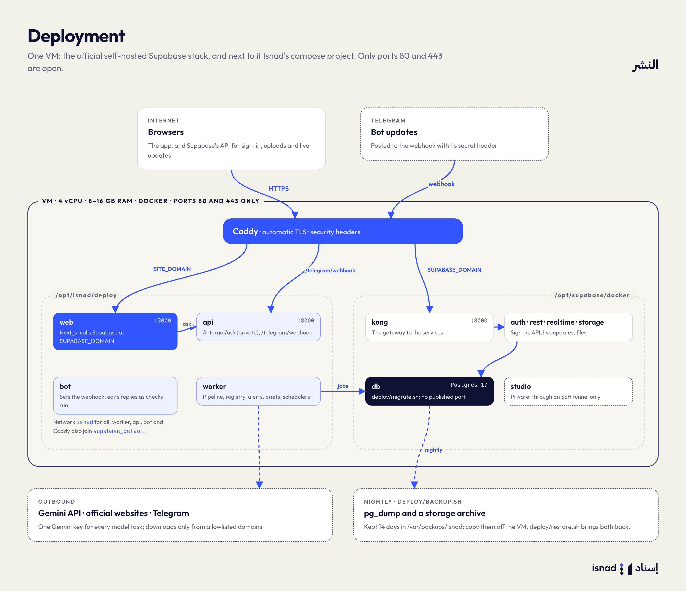

# Deployment

Isnad runs on one VM: the official self-hosted Supabase stack, and next to it the `deploy/`
compose project (web app, pipeline worker, worker API, Telegram bot, Caddy for HTTPS).



```
VM (4 vCPU, 8–16 GB RAM, 100 GB disk; a UAE region if available)
├── /opt/supabase/docker   Supabase (Postgres, Auth, REST, Realtime, Storage, Kong; Studio private)
└── /opt/isnad             this repository
    └── deploy/            web · worker · api · bot · caddy
                           (network isnad for all; worker, api, bot and caddy also join supabase_default)
```

Two public hostnames, both on Caddy with automatic TLS:

| Hostname | Routes to |
|---|---|
| `SITE_DOMAIN` (e.g. `isnad.ae`) | the web app; `/telegram/webhook` to the worker API |
| `SUPABASE_DOMAIN` (e.g. `api.isnad.ae`) | Supabase's gateway (auth, REST, realtime, storage) |

Studio, Postgres and the worker API's other routes are not exposed. The web app reaches Supabase through `SUPABASE_DOMAIN` (the public URL, also used server-side) and the worker API (`/internal/ask`) over the private `isnad` network.

## 1. Provision

1. A VM with Docker Engine and the compose plugin. Open ports 80 and 443 only; reach SSH from a
   fixed IP or a VPN.
2. DNS: A records for both hostnames pointing at the VM.
3. Clone the repository to `/opt/isnad`.

## 2. Supabase

Follow Supabase's self-hosting guide (`docker/` folder of github.com/supabase/supabase) into
`/opt/supabase/docker`:

- Generate fresh secrets: `POSTGRES_PASSWORD`, `JWT_SECRET`, and the `ANON_KEY` and
  `SERVICE_ROLE_KEY` signed with it. Never reuse the example values.
- Auth: `SITE_URL=https://SITE_DOMAIN`, `ADDITIONAL_REDIRECT_URLS=https://SITE_DOMAIN/**`,
  `API_EXTERNAL_URL=https://SUPABASE_DOMAIN`, `DISABLE_SIGNUP=true` (members join by invitation),
  and an SMTP provider (Resend, Postmark, SES) for magic links, invitations and password resets.
- Copy the email templates in `supabase/templates/` into the stack's auth configuration
  (`GOTRUE_MAILER_TEMPLATES_*` URLs or mounted files), so emails link to `/auth/confirm`.
- Turn off what Isnad doesn't use to save memory: edge functions, analytics/logging (Logflare,
  Vector), and the image proxy.
- Don't publish Studio or Postgres ports; reach Studio through an SSH tunnel.

`docker compose up -d`, then check `docker ps` shows `supabase-db`, `supabase-kong`,
`supabase-auth`, `supabase-rest`, `supabase-realtime`, `supabase-storage` healthy. The compose
project name must be `supabase` (the default for that folder) so its network is
`supabase_default`; otherwise set `SUPABASE_NETWORK`.

## 3. Isnad settings and secrets

```bash
cd /opt/isnad/deploy
cp .env.example .env && chmod 600 .env     # fill in every value
```

- `ANON_KEY`, `SERVICE_ROLE_KEY`, `POSTGRES_PASSWORD`: the same values as Supabase's `.env`.
  The anon key is the browser's publishable key; the service-role key is the server's secret
  key (the worker sends it as `apikey` and as a bearer token).
- `INTERNAL_API_TOKEN`, `TELEGRAM_WEBHOOK_SECRET`: `openssl rand -hex 32` each.
- `TELEGRAM_BOT_TOKEN`: the production bot's token (not the development bot's); revoke and
  reissue it in BotFather if it was ever shared in chat or committed anywhere.
- `GEMINI_API_KEY`: a Google AI Studio key on a project with billing enabled (every model task,
  transcription included). Set a budget alert on that project, and check its rate limits
  ([10-operations.md](10-operations.md#gemini-api)).
- `SITE_DOMAIN`, `SUPABASE_DOMAIN`, `ACME_EMAIL`: the two hostnames, and the address for Let's
  Encrypt.
- `TELEGRAM_BOT_USERNAME`: becomes `NEXT_PUBLIC_TELEGRAM_BOT_USERNAME` (the link on the settings
  page). Without `TELEGRAM_BOT_TOKEN`, set `TELEGRAM_MODE=off`, or the bot service exits and
  restarts in a loop.
- `SUPABASE_NETWORK` (default `supabase_default`), the worker's tuning (`WORKER_CONCURRENCY`,
  `JOB_TIMEOUT_MINUTES`, `DISCOVERY_ENABLED`, `WATCH_INTERVAL_HOURS`) and `ISNAD_VERSION` (the
  image tag) keep their defaults unless you need otherwise.

`NEXT_PUBLIC_*` values are compiled into the browser bundle, so changing the Supabase domain,
the anon key or the bot username needs a web rebuild.

## 4. Database and first start

```bash
cd /opt/isnad
deploy/migrate.sh                                   # applies supabase/migrations, once each
cd deploy && docker compose up -d --build
docker compose run --rm worker python -m isnad_worker.seed catalog
docker compose run --rm -it worker python -m isnad_worker.seed admin --email you@example.com --name "Your Name"
```

- `seed catalog` (the base seed, same as `seed base`) loads topics, indicators, entities and the
  trusted UAE sources (idempotent).
- `seed admin` creates the platform administrator (asks for a 12+ character password, or reads
  `ISNAD_ADMIN_PASSWORD`), who then
  creates newsrooms and invites their admins from the console.
- Don't run `seed demo-data`, `seed demo` or `seed all` in production: they create demo accounts
  with a known password. For a public demo server, run `seed demo-data` with the repository's
  `sample-data/` mounted at `/sample-data` (`-v /opt/isnad/sample-data:/sample-data:ro`; without
  it the stored documents and the clips are skipped), then change the demo passwords.
- To load the test corpus into the registry (it is already in the clone, under `sample-data/`), run
  `docker compose run --rm -v /opt/isnad/sample-data:/corpus -e ISNAD_CORPUS_DIR=/corpus worker python -m isnad_worker.seed documents`
  (it reads the documents with the model: a few dollars).

The bot service registers its webhook (`https://SITE_DOMAIN/telegram/webhook`, with the secret
header) on start; `docker compose logs bot` shows `webhook set`. The worker API rejects
updates without the secret.

## 5. Checks after deploying

- `https://SITE_DOMAIN/ar/sign-in` loads; sign in as the administrator.
- `docker compose ps`: all services up; `web` and `api` healthy.
- Submit a short text check with a number; it should reach "awaiting review" within a minute.
- Message the bot `/help`; link a test account from Settings → Link Telegram.
- `docker compose logs -f worker` shows jobs starting and finishing, with no tracebacks.

## 6. Operations

**Logs**: `docker compose logs -f web worker api bot`. Docker's default json-file driver keeps
logs on disk; cap them in `/etc/docker/daemon.json` (`"log-opts": {"max-size": "20m", "max-file": "5"}`).

**Monitoring**: alert on `https://SITE_DOMAIN/ar/sign-in` and on the worker API health
(`docker compose exec api python -c "import urllib.request; urllib.request.urlopen('http://127.0.0.1:8000/health')"`),
disk usage (media and backups grow), and failed jobs:

```sql
select kind, count(*), max(finished_at) from public.jobs
where status = 'failed' and finished_at > now() - interval '1 day' group by kind;
```

Model spend is in `public.usage_events` (`sum(cost_usd)` per day and task); the console shows it
by day and task (**Quality and models**) and this month's cost per newsroom (**Newsrooms**).

**Backups**: `deploy/backup.sh` (cron, nightly) writes a `pg_dump` and a storage archive to
`/var/backups/isnad` and keeps 14 days. Copy that folder off the VM (rclone or restic to object
storage); test a restore on a scratch VM every quarter.

**Restore**: `deploy/restore.sh /var/backups/isnad/db-<stamp>.dump /var/backups/isnad/storage-<stamp>.tar.gz`
(absolute paths: the script changes directory first) asks you to type `RESTORE`, stops Isnad and
Supabase Storage, restores the database, moves the old `volumes/storage` aside and unpacks the
archive, then starts everything again. `backup.sh` and `restore.sh` read `DB_CONTAINER`,
`SUPABASE_DIR`, `BACKUP_DIR` and `KEEP_DAYS`; the cron line is in `backup.sh`'s header.
`deploy/migrate.sh` records applied migrations in `supabase_migrations.schema_migrations`, so
`supabase migration list --db-url …` agrees with it.

## 7. Upgrades

- Isnad: `git pull`, `deploy/migrate.sh`, `docker compose up -d --build`. Migrations run before
  the new images start; they're written to be compatible with the previous release for the few
  seconds both run.
- Supabase: read its changelog, back up first, bump the image tags in its compose file,
  `docker compose pull && docker compose up -d`.
- Rotating a secret: update `deploy/.env` (and Supabase's `.env` for its keys), then
  `docker compose up -d` (rebuild `web` when the anon key changes).

## 8. Local images

The images build on a laptop from the repository root:

```bash
docker build -f deploy/worker.Dockerfile -t isnad-worker .
docker build -f deploy/web.Dockerfile -t isnad-web \
  --build-arg NEXT_PUBLIC_SUPABASE_URL=... --build-arg NEXT_PUBLIC_SUPABASE_PUBLISHABLE_KEY=... .
```

Each Dockerfile has its own `.dockerignore` (`deploy/*.Dockerfile.dockerignore`) that sends
only the code it needs, never env files, `node_modules` or the test corpus.

---

[← Local development and operations](10-operations.md) · [Documentation](../README.md)
