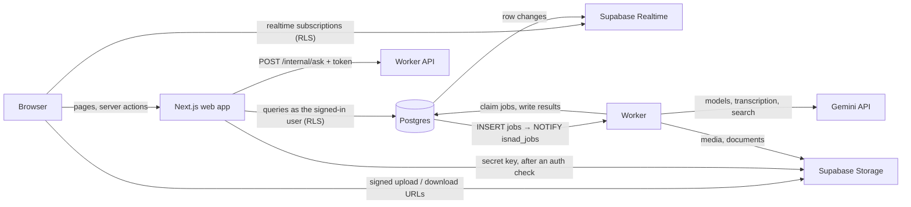

# Architecture

Isnad has three running parts around one database. The web app and the worker never call each other for core work: the database is the contract between them.

## Components

| Component | Path | Stack | Role |
|---|---|---|---|
| Web app | `web/` | Next.js 16 (App Router, `cacheComponents`), React 19, TypeScript, Tailwind v4 | All screens, server actions, the public evidence page |
| Worker | `worker/` (`isnad_worker.runner`) | Python 3.12, uv, psycopg, Google Gen AI SDK (Gemini API) | The processing pipeline, registry ingestion, alerts, briefs |
| Worker API | `worker/` (`isnad_worker.api`) | FastAPI | `/health`, and internal endpoints the web app calls with a shared token (`/internal/ask`) |
| Platform | `supabase/` | Self-hosted Supabase: Postgres 17, Auth, Storage, Realtime | Data, sign-in, files, live updates |

## Data flow

A typical check:

1. The browser uploads a file straight to Storage with a signed upload URL issued by a server action, then calls `createCheck`.
2. The server action inserts a row in `checks`. A trigger enqueues a `process_check` job.
3. The job insert fires `NOTIFY isnad_jobs`. A worker thread wakes up and claims the job.
4. The worker writes segments, claims and results as it goes, and updates `checks.stage` and `checks.progress`.
5. Realtime pushes those row changes to the browser, which refreshes the server-rendered page.
6. Editors decide through security-definer SQL functions (`decide_claim`, `approve_check`, ...). See [pipeline.md](pipeline.md) and [security.md](security.md).

## Job queue

Jobs live in the `jobs` table (`kind`, `payload`, `status`, `priority`, `attempts`, `run_after`, `dedupe_key`).

- **Enqueue:** only from SQL (`enqueue_job`, not callable by clients) or from the worker (`jobs.enqueue`). Triggers enqueue `process_check` on a new check, `generate_brief` on a new brief, and `run_eval` on a new evaluation run. Workflow functions enqueue re-checks and searches.
- **Dedupe:** a unique index on `dedupe_key` while a job is queued or running. For example `check:<id>` keeps one pipeline job per check.
- **Claim:** `UPDATE ... WHERE id = (SELECT ... FOR UPDATE SKIP LOCKED)`, by priority then age, only for kinds the worker has a handler for. Several workers can run side by side.
- **Wake-up:** `LISTEN isnad_jobs`, with polling as a fallback (`POLL_INTERVAL_SECONDS`).
- **Retries:** `RetryableError` and unexpected errors retry with backoff (30 s × 2ⁿ) up to `max_attempts` (3). `PermanentError` fails at once.
- **Stale jobs:** a scheduler thread puts jobs left running past `JOB_TIMEOUT_MINUTES` back in the queue, and prunes finished jobs after 30 days.
- **Shutdown:** SIGINT/SIGTERM stops claiming and waits up to 120 s for running jobs; a second signal exits at once.

Job kinds and their handlers are listed in [worker.md](worker.md).

## Realtime

These tables are in the `supabase_realtime` publication: `checks`, `claims`, `claim_results`, `segments`, `comments`, `alerts`, `briefs`, `document_versions`, `eval_runs`. Subscriptions respect row-level security, so a user only receives changes to rows they can read.

The browser joins channels through `subscribeAsUser` (`web/src/lib/supabase/realtime.ts`). It loads the session and sets the realtime token before subscribing. A channel joined before that would join as anonymous and receive nothing. Pages then call `router.refresh()` (debounced), so the server stays the single source of rendered data.

## Storage

| Bucket | Size limit | What it holds |
|---|---|---|
| `media` | 500 MB per file | Uploaded clips and documents for checks (`<newsroom>/<uuid>/original.<ext>`), plus the worker's web-playable copy (`web.mp4` or `web.m4a`) and poster (`poster.jpg`) |
| `documents` | 100 MB per file | Registry document snapshots (`<source>/<document>/v<n>.<ext>`) and console inbox uploads (`inbox/<uuid>/<name>`) |

Both buckets are private and have no client policies. Uploads use signed upload URLs that a server action issues after checking the user. Reads use short-lived signed URLs (6 hours for check media) that the server creates after row-level security has confirmed the viewer can see the row. Each bucket only accepts listed media types.

Uploaded check media is deleted after the newsroom's retention period (`media_retention_days`, default 90) by the daily `retention_cleanup` job. Transcripts, results and decisions stay.

## AI gateway

Every model call goes through `isnad_worker.ai.gateway`:

All model work runs on the Gemini API with one key (`GEMINI_API_KEY`).

- **Per-task settings** come from `model_settings` (task → model, thinking level, escalation model, max tokens, enabled), cached for 60 seconds. Platform admins edit them in the console.
- **Cheap first, escalate on evidence.** Tasks run on Gemini 3.5 Flash-Lite, except figure extraction (below). Three tasks have an escalation model (Gemini 3.8 Flash) that is asked again only when code checks reject the cheap answer, and only with the part that failed (`gateway.can_escalate`, `parse(..., escalate=True)`). Code also cleans the input before any model reads it: extraction skips lines without a number, discovery reads only the passages of a downloaded document that mention the indicator, the claim's numbers or the period.
- **Switching off:** `extract_claims`, `extract_figures` and `transcribe` can't be switched off (a check constraint). A switched-off optional task raises `TaskDisabled`, and its callers fall back: no discovery, no verifier note, template wording.
- **Structured output:** `gateway.parse` sends the Pydantic model's JSON schema (`response_json_schema`) and validates the answer. Safety blocks raise `ModelRefusal`; answers cut off at `max_tokens` or not matching the schema raise `ModelOutputError`.
- **Resilience:** the client retries 408, 429 and 5xx with backoff (5 attempts).
- **Caching:** the stable system prompt comes first, so Gemini's implicit prefix caching applies to repeated calls.
- **Cost:** every call records tokens (input, audio, cached, output including thinking), Google Search queries, audio seconds, duration and an estimated USD cost in `usage_events`, tagged with the newsroom and check. Search queries are recorded at the paid rate ($14 per 1,000) although the first 5,000 a month are free.

| Task | Model | Thinking | Escalates to Gemini 3.8 Flash when |
|---|---|---|---|
| `transcribe` | Gemini 3.5 Transcribe | — | — |
| `extract_claims` | Gemini 3.5 Flash-Lite | low | a span isn't in the text, a statistic-looking number has no claim, or the answer doesn't parse (only those segments are reread) |
| `verify_claim` | Gemini 3.5 Flash-Lite | low | the cheap verifier objects or has low confidence (the stronger reading stands) |
| `discover_source` | Gemini 3.5 Flash-Lite + Google Search | low | the figure it reads from a found document disagrees with the claim (Flash re-reads the same passages) |
| `extract_figures` | Gemini 3.8 Flash (PDFs read natively) | low | — (on an 8-page bulletin Flash found 19 figures, all verified, for $0.021; Flash-Lite found 3, or 10 with medium thinking for the same $0.021. With Flash-Lite as the model and Flash as escalation, a batch where fewer than half the figures verify is reread) |
| `suggest_wording` | Gemini 3.5 Flash-Lite | minimal | — (code checks the numbers; the template is the fallback) |
| `ask_registry` | Gemini 3.5 Flash-Lite | low | the number check rejects the first answer (the retry goes to Flash) |
| `generate_brief` | Gemini 3.5 Flash-Lite | low | — |

Why these models (prices per million tokens, October 2026): Flash-Lite costs $0.30 in / $2.50 out, Flash $0.75 / $3.75 (doubling on 1 January 2027). Gemini 3.5 Transcribe costs about $0.005 a minute and returns word timings and speakers; on the test clips it transcribed every number correctly, while Flash-Lite cost the same (its transcripts are longer) and corrupted Arabic letters.

Measured on the 60 labelled claims (`make eval`, same comparison rules): Flash-Lite extraction with escalation scored 73.3% (44/60) for $1.72, and Flash extraction also 73.3% for $1.90, with different misses, so extraction stays on Flash-Lite. Claude Opus scored 83.3% on the same rules; the gap is mostly the place a claim is about when the sentence doesn't name it (Gemini defaults to "UAE" where Opus inferred Dubai or Abu Dhabi from the wording), which a full article usually settles. Evidence shown was 100% verified in every run. Later full runs, with the fixes found on real clips, scored 70.0% and, re-compared after the earlier-period rule, 68.3% with false alarms down from 2 to 1: runs vary by about two claims because search results and the cheap model's period and place readings vary. Of the $1.72, $1.41 was Google Search queries at the paid rate (inside the free 5,000 a month, so not billed); model tokens came to about $0.004 a check. On the local stack: a seven-number text check cost $0.0098 (one Flash call), a check with one source search $0.02, a 37-second audio check $0.039 including two searches.

Prompts are plain Markdown files in `worker/src/isnad_worker/prompts/`.

## Where things are decided

The product rule is: the model extracts, code compares, an editor decides.

| Decision | Made by |
|---|---|
| Which numbers a text contains, and their fields | Model (`extract_claims`), then code anchors the exact span and re-reads the number |
| Whether a figure is evidence | Code: the quote or cell must be found verbatim in the stored document |
| The verdict | Code: fixed comparison rules ([pipeline.md](pipeline.md)) |
| A second opinion | Model (`verify_claim`); it can only flag a number for review, never change the verdict |
| Approval and publication | A human editor |

## Related

- [data-model.md](data-model.md), [security.md](security.md), [pipeline.md](pipeline.md), [registry.md](registry.md), [web-app.md](web-app.md), [worker.md](worker.md), [operations.md](operations.md)
