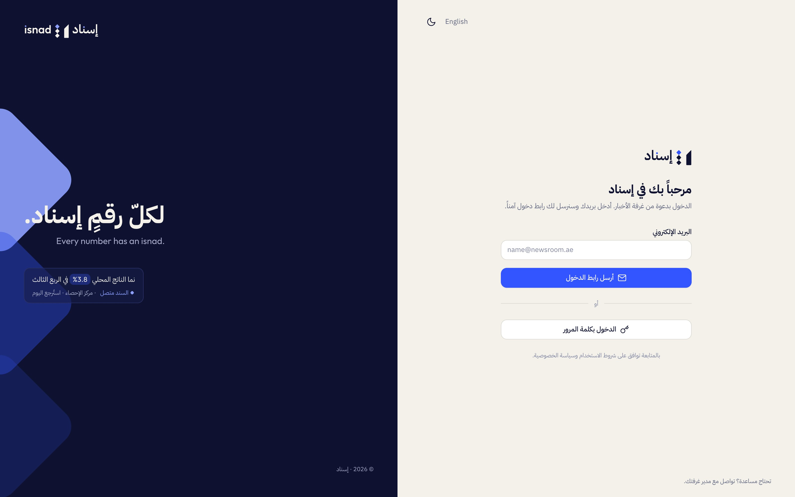
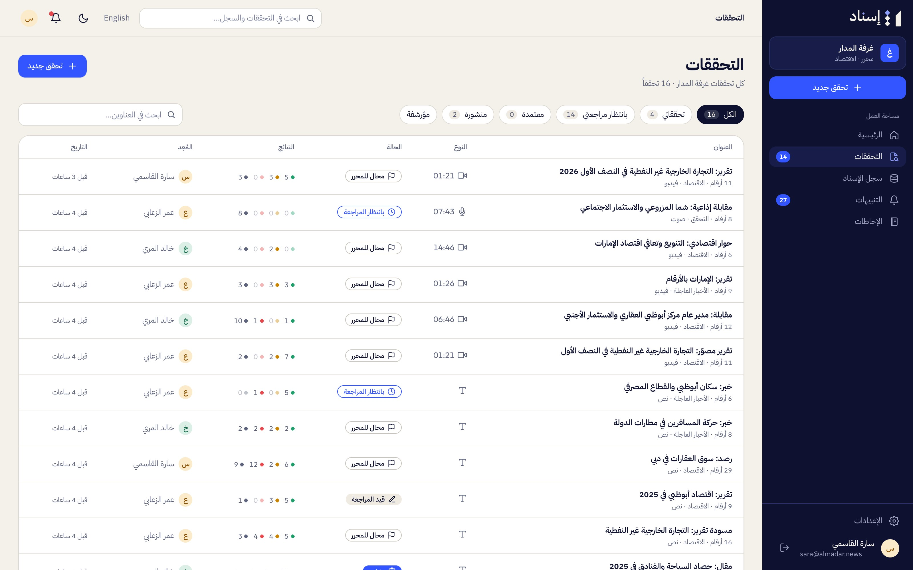
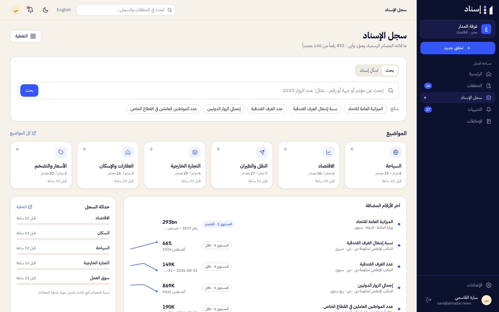
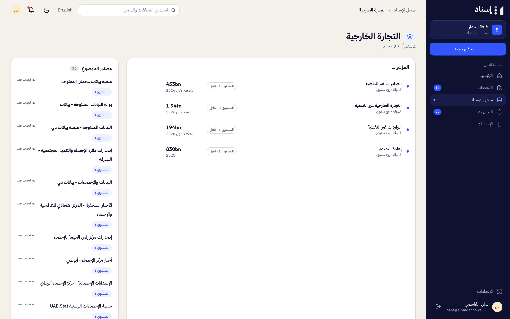
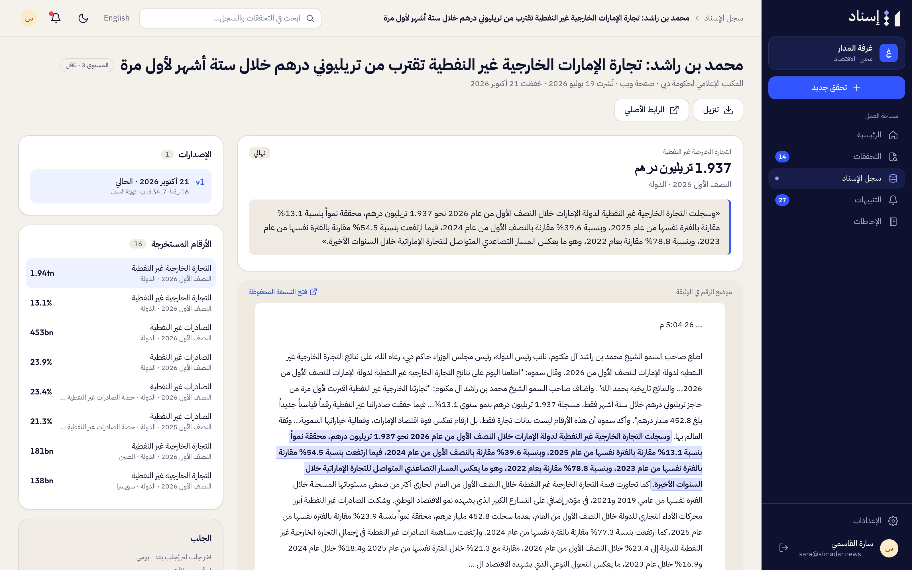
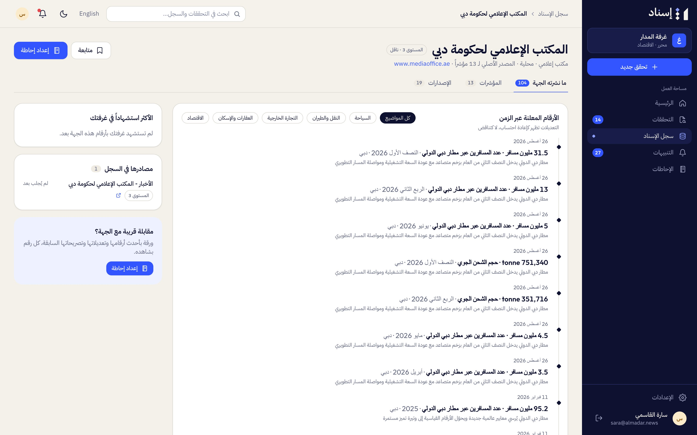
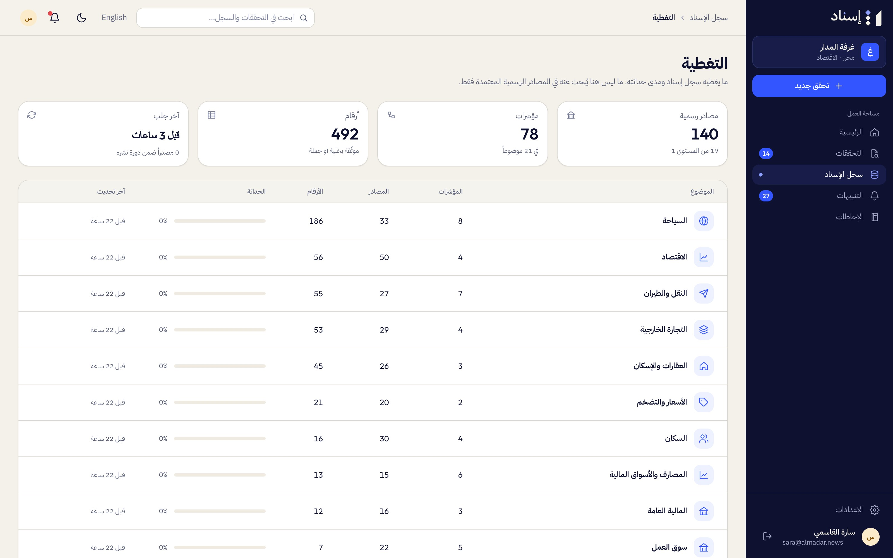
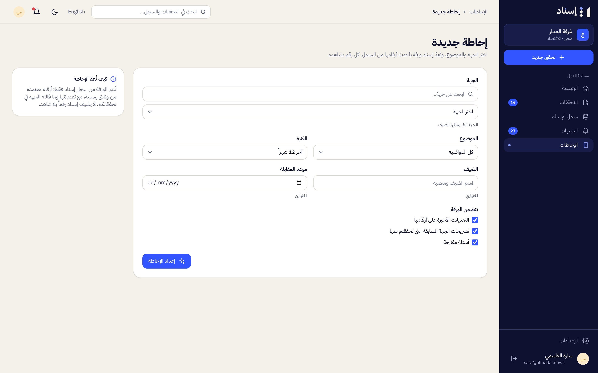
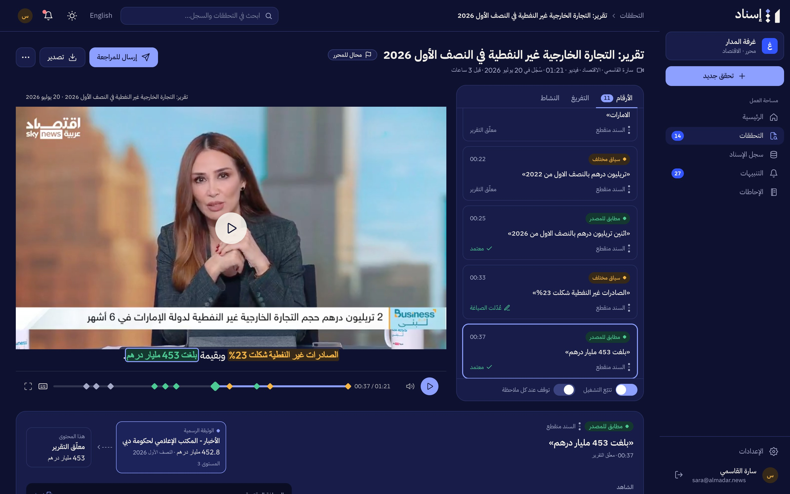

# Screenshots

The product as it runs with the demo data (`make seed-demo`), in Arabic with the light theme unless noted.
Click a picture for the full size (2× pixel density).

## Newsroom

Sara, an editor at غرفة المدار

<table>
<tr><td width="50%" valign="top"><a href="01-sign-in.jpg"></a><br><sub><b>01</b> · Sign-in</sub></td><td width="50%" valign="top"><a href="02-home.jpg"></a><br><sub><b>02</b> · Home: upload area, this week's checks, what awaits review</sub></td></tr>
<tr><td width="50%" valign="top"><a href="03-new-check.jpg"></a><br><sub><b>03</b> · New check: a clip, file, link or text, with the recording date, dialect and who can see it</sub></td><td width="50%" valign="top"><a href="04-check-processing.jpg"></a><br><sub><b>04</b> · A check in progress: each stage, and numbers appearing as they are checked (a frame of the demo recording)</sub></td></tr>
<tr><td width="50%" valign="top"><a href="05-checks.jpg"></a><br><sub><b>05</b> · All checks, with status and verdict counts</sub></td></tr>
</table>

## The check page

A Sky News Arabia report and a written article from the demo

<table>
<tr><td width="50%" valign="top"><a href="06-check-video-and-numbers.jpg"></a><br><sub><b>06</b> · The clip with synced captions, numbers coloured by verdict on the timeline, and a card per number</sub></td><td width="50%" valign="top"><a href="07-check-match-evidence.jpg"></a><br><sub><b>07</b> · A match: 453bn against the Dubai Media Office's 452.8bn, with the chain, the verbatim quote, the comparison, the verifier and the suggested wording</sub></td></tr>
<tr><td width="50%" valign="top"><a href="08-check-different-context.jpg"></a><br><sub><b>08</b> · Different context: 23% against 23.4% of total non-oil trade</sub></td><td width="50%" valign="top"><a href="09-check-no-source.jpg"></a><br><sub><b>09</b> · No source found: the official sites that were searched</sub></td></tr>
<tr><td width="50%" valign="top"><a href="10-check-differs-article.jpg"></a><br><sub><b>10</b> · A written article, numbers highlighted: 95.2 million passengers "in the first half"</sub></td><td width="50%" valign="top"><a href="11-check-differs-evidence.jpg"></a><br><sub><b>11</b> · Differs: the Dubai Airports document says 46 million in the first half</sub></td></tr>
<tr><td width="50%" valign="top"><a href="12-check-transcript.jpg"></a><br><sub><b>12</b> · The transcript, with speakers and highlighted numbers</sub></td></tr>
</table>

## The editor decides

<table>
<tr><td width="50%" valign="top"><a href="13-editor-edit-wording.jpg"></a><br><sub><b>13</b> · Editing the suggested wording</sub></td><td width="50%" valign="top"><a href="14-editor-escalate.jpg"></a><br><sub><b>14</b> · Escalating a number with a note</sub></td></tr>
<tr><td width="50%" valign="top"><a href="15-public-evidence-page.jpg"></a><br><sub><b>15</b> · The public evidence page readers see after publication</sub></td></tr>
</table>

## The registry

Official figures, read once and reused

<table>
<tr><td width="50%" valign="top"><a href="16-registry.jpg"></a><br><sub><b>16</b> · Search, topics and the latest figures</sub></td><td width="50%" valign="top"><a href="17-registry-topic.jpg"></a><br><sub><b>17</b> · A topic: its indicators and sources</sub></td></tr>
<tr><td width="50%" valign="top"><a href="18-registry-indicator.jpg"></a><br><sub><b>18</b> · An indicator: definition, series, sources and figures by period</sub></td><td width="50%" valign="top"><a href="19-registry-document.jpg"></a><br><sub><b>19</b> · A stored official document: its figures, where each sits in the text, its versions</sub></td></tr>
<tr><td width="50%" valign="top"><a href="20-registry-entity.jpg"></a><br><sub><b>20</b> · A publisher and its figures over time</sub></td><td width="50%" valign="top"><a href="21-registry-coverage.jpg"></a><br><sub><b>21</b> · What the registry covers, by topic</sub></td></tr>
</table>

## Ask, briefs, alerts

<table>
<tr><td width="50%" valign="top"><a href="22-ask-isnad.jpg"></a><br><sub><b>22</b> · Ask Isnad: an answer from official figures, with its evidence</sub></td><td width="50%" valign="top"><a href="23-brief-new.jpg"></a><br><sub><b>23</b> · Preparing an interview brief</sub></td></tr>
<tr><td width="50%" valign="top"><a href="24-brief.jpg"></a><br><sub><b>24</b> · An interview brief: the entity's figures and what it said before</sub></td><td width="50%" valign="top"><a href="25-alerts.jpg"></a><br><sub><b>25</b> · Alerts: revised figures, new releases, checks ready, escalations</sub></td></tr>
<tr><td width="50%" valign="top"><a href="26-settings-telegram.jpg"></a><br><sub><b>26</b> · Linking Telegram from the settings</sub></td></tr>
</table>

## Newsroom admin

Laila, admin of غرفة المدار

<table>
<tr><td width="50%" valign="top"><a href="27-admin-members.jpg"></a><br><sub><b>27</b> · Members, roles, desks and invitations</sub></td><td width="50%" valign="top"><a href="28-admin-policies.jpg"></a><br><sub><b>28</b> · Policies: review, retention, visibility, Telegram</sub></td></tr>
<tr><td width="50%" valign="top"><a href="29-admin-private-sources.jpg"></a><br><sub><b>29</b> · The newsroom's private sources</sub></td><td width="50%" valign="top"><a href="30-admin-activity.jpg"></a><br><sub><b>30</b> · Activity and usage: checks, minutes processed, cost</sub></td></tr>
</table>

## Isnad team console

The platform admin

<table>
<tr><td width="50%" valign="top"><a href="31-console-sources.jpg"></a><br><sub><b>31</b> · The 140 official sources, with tiers and health</sub></td><td width="50%" valign="top"><a href="32-console-inbox.jpg"></a><br><sub><b>32</b> · Documents with figures waiting for review</sub></td></tr>
<tr><td width="50%" valign="top"><a href="33-console-figure-review.jpg"></a><br><sub><b>33</b> · Reviewing an extracted figure in place in its document</sub></td><td width="50%" valign="top"><a href="34-console-catalog.jpg"></a><br><sub><b>34</b> · The indicator catalog</sub></td></tr>
<tr><td width="50%" valign="top"><a href="35-console-newsrooms.jpg"></a><br><sub><b>35</b> · Newsrooms, usage and cost</sub></td><td width="50%" valign="top"><a href="36-console-quality.jpg"></a><br><sub><b>36</b> · Quality and models: evaluation runs, accuracy, the model and cost per task</sub></td></tr>
<tr><td width="50%" valign="top"><a href="37-console-system.jpg"></a><br><sub><b>37</b> · System: the job queue</sub></td></tr>
</table>

## Other views

<table>
<tr><td width="50%" valign="top"><a href="38-check-english.jpg"></a><br><sub><b>38</b> · The check page in English</sub></td><td width="50%" valign="top"><a href="39-check-dark.jpg"></a><br><sub><b>39</b> · The dark theme</sub></td></tr>
</table>

## On a phone

<table>
<tr><td width="50%" valign="top"><a href="40-public-evidence-page-phone.jpg"></a><br><sub><b>40</b> · The public evidence page on a phone</sub></td><td width="50%" valign="top"><a href="41-check-phone.jpg"></a><br><sub><b>41</b> · The check page on a phone</sub></td></tr>
</table>

## Taking them again

With the app running on the demo data (`make db-reset`, `make dev`):

```bash
make screenshots
```

This runs `web/scripts/screenshots.mjs`: it signs in as each demo role, opens the screens above and
saves them here (Chrome from `npx playwright install chromium`, or `CHROME_PATH`). Dialogs are only
opened, never saved; Ask Isnad's question costs one small model call. `04-check-processing.jpg` is a
frame of the demo recording, since that screen only exists while a check is running.
